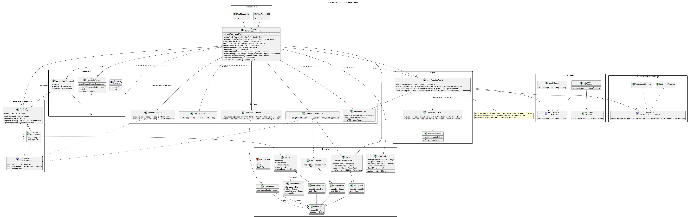
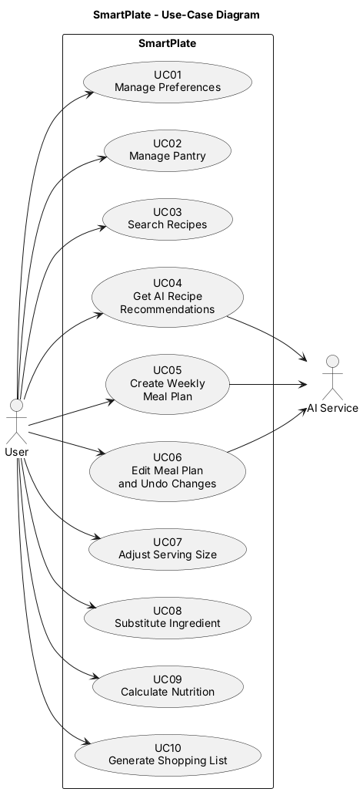
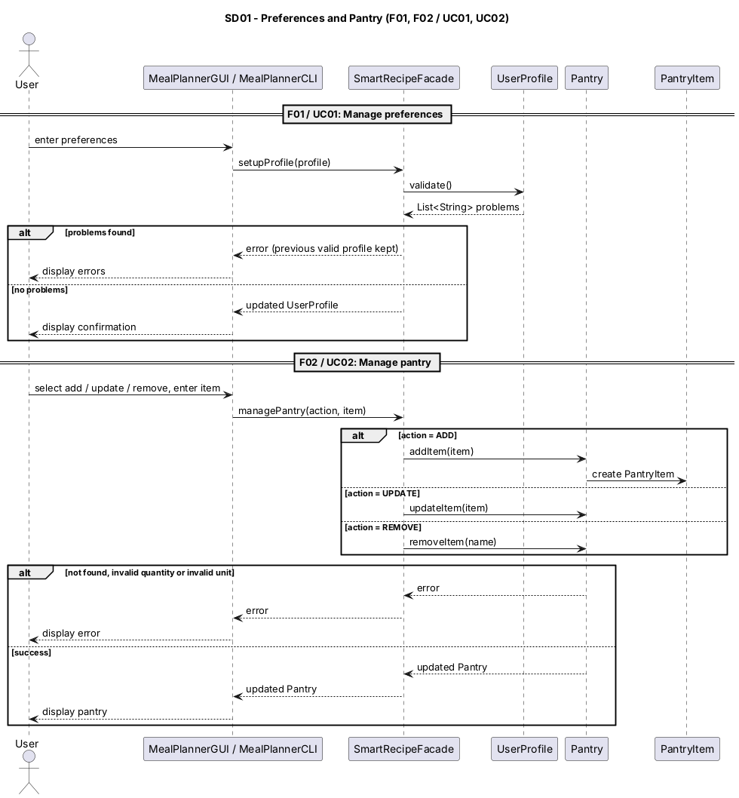
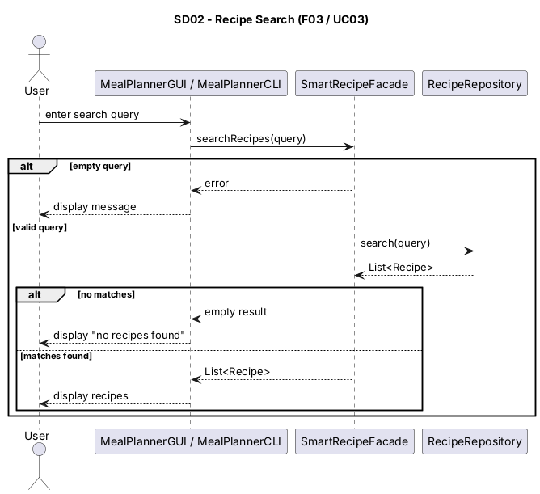
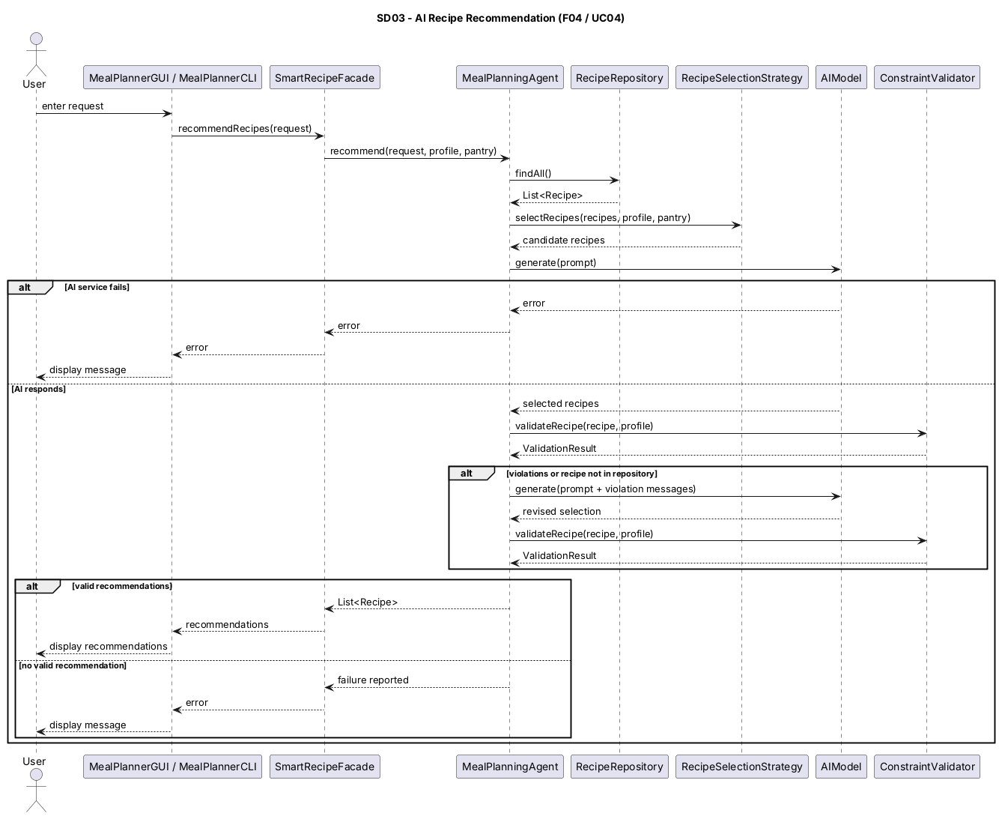
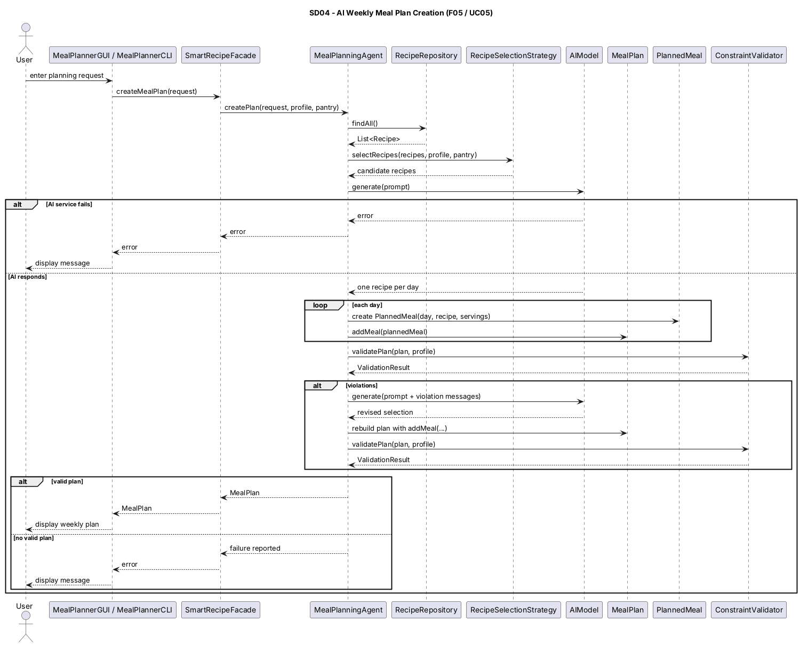
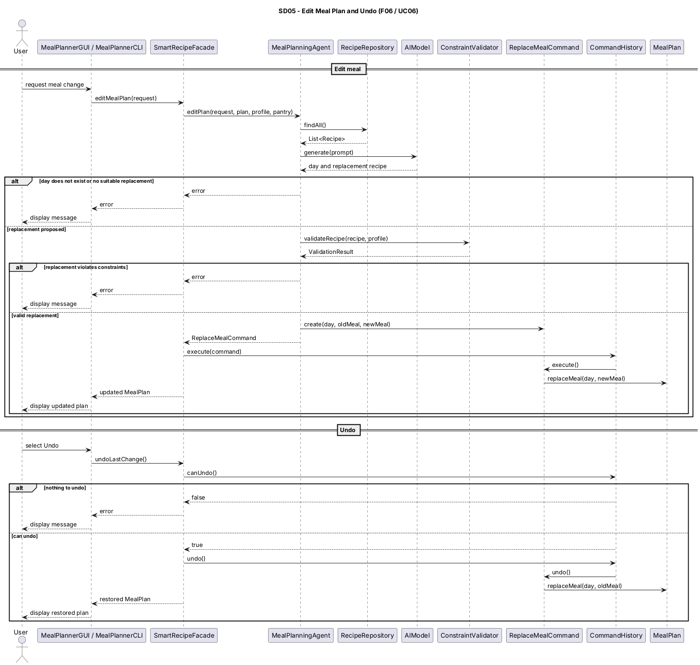
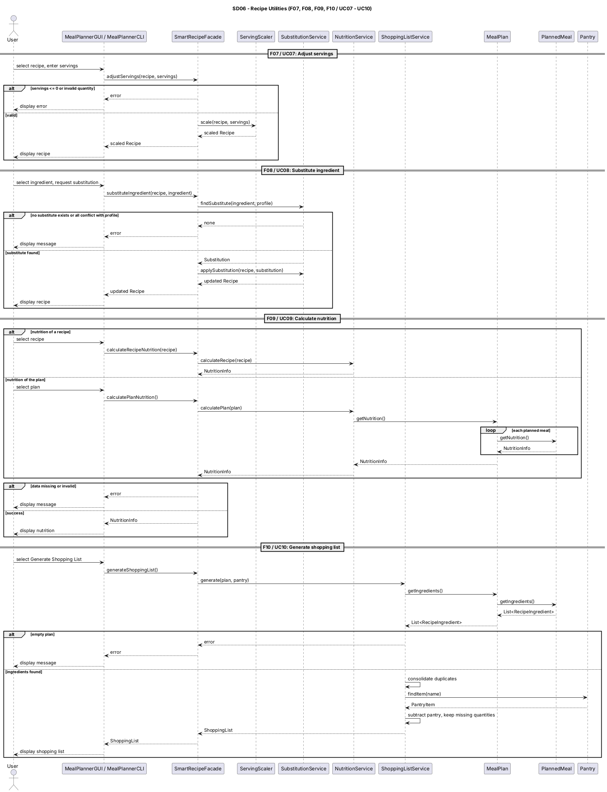

EECS3311 Fall 2026 — Stage 1 Project Design Report
SmartPlate: AI Smart Recipe and Meal Planning Agent

1. Project Overview
   1.1 Problem and Motivation
   Planning meals for a week means balancing dietary preferences, allergies, disliked ingredients, pantry contents, cooking time, serving sizes, nutrition, and grocery needs at the same time. Ordinary recipe apps offer search and filters, but they do not reason across all of these constraints. Users must search for recipes, assemble a weekly plan, check each meal against their restrictions, work out the ingredients, and write a shopping list by hand.

SmartPlate is an AI agent that turns a natural-language request ("Plan dinners for this week, use some of my pantry items, avoid mushrooms, keep meals under 30 minutes") into a validated weekly meal plan. It lets the user modify the plan conversationally and undo changes. Deterministic Java components handle validation, nutrition, serving scaling, substitutions, pantry management, and shopping lists, so the system is more than a single LLM API call.

1.2 Target Users
Students and young professionals who want simple weekly meal planning.
Individuals with dietary preferences, restrictions, or allergies.
Users who want to cook with ingredients they already have.
Users who want to reduce grocery waste and repeated shopping trips.
1.3 Agent Description: What the Agent Can Do
Understand natural-language meal-planning requests.
Respect the user's preferences, allergies, dislikes, and time limit.
Take the pantry into account.
Recommend recipes from the recipe repository.
Build a weekly meal plan.
Modify the plan from a natural-language request, and undo the change.
Select recipes with a configurable strategy (pantry-first or fastest).
Validate every AI recommendation and plan before showing it.
Adjust servings, substitute ingredients, calculate nutrition, and generate a shopping list.
Scope assumptions (kept deliberately simple):

A plan has one meal per day (dinner), for 5 to 7 days.
The AI selects from existing recipes in RecipeRepository. It does not invent recipes.
Supported units are g, kg, ml, l and pcs only.
Ingredient substitutions come from a predefined list; the AI does not invent substitutions.
1.4 Why an AI Agent Is Appropriate
Meal planning is a constraint-based decision problem. A single prompt to an LLM cannot be trusted with allergies, pantry contents, or exact quantities. The agent:

Interprets the user's request.
Retrieves recipes from the repository.
Considers the user's profile and pantry.
Applies a recipe-selection strategy to shortlist candidates.
Asks the AI model to choose among the candidates.
Validates the choice with deterministic code (ConstraintValidator).
If violations are found, revises once using the violation messages; otherwise reports failure.
Returns a validated result, and can later modify it on request.
The LLM proposes; deterministic code decides. An allergen violation is never shown as a valid plan.

1.5 AI / LLM Model
The system is designed around the AIModel abstraction and is not tied to one provider. The agent calls AIModel.generate(prompt). AIAdapter translates this call into the request expected by the provider-specific AIClient. The provider, model name, and API key are read from configuration (the key from an environment variable), so the provider can change without touching MealPlanningAgent.

1.6 How the AI Interacts with the Rest of the System
The GUI and CLI never call the LLM directly. The flow is:

GUI/CLI → SmartRecipeFacade → MealPlanningAgent → (RecipeRepository, RecipeSelectionStrategy, AIModel) → ConstraintValidator → domain objects → result

MealPlanningAgent
|
AIModel
/ \
AIAdapter MockAIModel
|
AIClient
|
External LLM
A MockAIModel implements the same AIModel interface so the system can run and be tested without an external LLM. Normal development and testing therefore need no API calls.

1.7 Overall Architecture
The system follows a layered architecture.

+--------------------------------------------------+
| Presentation Layer |
| MealPlannerGUI MealPlannerCLI |
+------------------------|-------------------------+
v
+--------------------------------------------------+
| Application Layer |
| SmartRecipeFacade |
+--------------------------------------------------+
| | |
v v v
MealPlanningAgent Services CommandHistory
|
+--> RecipeSelectionStrategy
+--> ConstraintValidator
+--> AIModel (AIAdapter -> AIClient, or MockAIModel)

+--------------------------------------------------+
| Domain Layer |
| Recipe | MealPlan | PlannedMeal | Pantry |
| PantryItem | UserProfile | Ingredient |
| RecipeIngredient | ShoppingList | ShoppingItem |
| NutritionInfo | Substitution |
+--------------------------------------------------+

+--------------------------------------------------+
| Data Layer |
| RecipeRepository |
+--------------------------------------------------+
MealPlannerGUI and MealPlannerCLI are the presentation classes in the class diagram. Both call only SmartRecipeFacade.
SmartRecipeFacade is the single entry point for every feature.
MealPlanningAgent does the AI-assisted work (recommend, plan, edit).
Services (NutritionService, ServingScaler, SubstitutionService, ShoppingListService) do the deterministic work. 2. Detailed Feature Specifications
The project has 10 features.

ID Feature Type
F01 Preference Profile Management Deterministic
F02 Pantry Inventory Management Deterministic
F03 Recipe Search Deterministic
F04 AI Recipe Recommendation Hybrid
F05 AI Weekly Meal Planning Hybrid
F06 Meal Plan Editing and Undo Hybrid
F07 Serving-Size Adjustment Deterministic
F08 Ingredient Substitution Deterministic
F09 Nutrition Information Deterministic
F10 Shopping List Generation Deterministic
Hybrid means the AI model makes a choice and deterministic code validates it. Deterministic means no AI is involved.

Note for all hybrid features (F04, F05, F06): the AI selects from existing recipes in RecipeRepository; it does not invent recipes. A recipe name or id that is not in the repository is rejected.

F01 — Preference Profile Management
Description: Lets the user configure dietary preferences, allergies, disliked ingredients, maximum cooking time, and default serving size.

User Interaction: The user opens the preferences section in the GUI or uses the CLI profile command.

Input: Dietary preferences, allergies, disliked ingredients, maximum cooking time, default servings.

Output: Updated UserProfile.

AI Involvement: Deterministic.

Expected Workflow:

The user enters or modifies preferences.
SmartRecipeFacade.setupProfile(profile) receives them.
UserProfile.validate() returns a list of problems.
If there are no problems, the profile is stored and returned. If there are problems, the previous valid profile is kept.
Later recommendations and plans use the updated profile.
Error/Alternative Cases: Servings less than 1; cooking time less than 1; duplicate or malformed entries. The system rejects invalid input and keeps the previous valid profile.

F02 — Pantry Inventory Management
Description: Lets the user add, update, remove, and view the ingredients currently in the pantry.

User Interaction: The user opens the pantry screen or uses the CLI pantry commands.

Input: Ingredient, quantity, unit, and an action (ADD, UPDATE or REMOVE).

Output: Updated Pantry.

AI Involvement: Deterministic.

Expected Workflow:

The user selects a pantry operation.
SmartRecipeFacade.managePantry(action, item) processes it (action is ADD, UPDATE or REMOVE).
Pantry adds, updates, or removes the PantryItem.
The updated pantry is displayed.
Error/Alternative Cases: Item does not exist when updating or removing; quantity is zero or negative; unit is not one of g, kg, ml, l, pcs.

F03 — Recipe Search
Description: Searches the recipe repository for recipes matching a name, ingredient, or search term.

User Interaction: The user types a query in the search box (GUI) or uses the CLI search command.

Input: Search query.

Output: List of matching Recipe objects.

AI Involvement: Deterministic.

Expected Workflow:

The user submits a query.
SmartRecipeFacade.searchRecipes(query) is called.
RecipeRepository.search(query) searches the recipe collection.
Matching recipes are returned and displayed.
Error/Alternative Cases: Empty query; no matching recipes.

F04 — AI Recipe Recommendation
Description: Recommends recipes that fit the user's preferences, pantry contents, and natural-language request.

User Interaction: The user types a request such as "quick vegetarian dinners using rice" in the AI assistant area (GUI) or CLI.

Input: Natural-language request, UserProfile, Pantry, recipes in the repository.

Output: A list of recommended Recipe objects.

AI Involvement: Hybrid. The strategy shortlists candidates, the AI model chooses among them, and ConstraintValidator checks the result.

Expected Workflow:

The user enters a request.
SmartRecipeFacade.recommendRecipes(request) calls MealPlanningAgent.recommend(request, profile, pantry).
The agent loads recipes from RecipeRepository.
RecipeSelectionStrategy.selectRecipes() shortlists candidates.
The AIModel selects recipes from the candidates.
ConstraintValidator.validateRecipe() checks each selected recipe and returns a ValidationResult.
If there are violations, the agent revises once, adding the violation messages to the prompt.
Valid recommendations are returned; otherwise the failure is reported.
Error/Alternative Cases: No recipe satisfies the constraints; the AI names a recipe that is not in the repository; the AI service fails; the user's constraints contradict each other. The system reports the problem instead of showing an invalid recommendation.

F05 — AI Weekly Meal Planning
Description: Creates a meal plan of 5 to 7 days (one dinner per day) from the user's preferences, pantry, and request.

User Interaction: The user asks the agent to create a weekly plan.

Input: Natural-language request, UserProfile, Pantry, recipe repository.

Output: MealPlan.

AI Involvement: Hybrid.

Expected Workflow:

The user submits a planning request.
SmartRecipeFacade.createMealPlan(request) calls MealPlanningAgent.createPlan(request, profile, pantry).
The agent loads recipes and the strategy shortlists candidates.
The AI model selects one recipe for each day from the candidates.
The agent creates a PlannedMeal for each day and adds it to a MealPlan.
ConstraintValidator.validatePlan() validates the plan (allergens, dislikes, diet, cooking time, one meal per day, 5 to 7 days).
If there are violations, the agent revises once with the violation messages.
A valid plan is returned; otherwise failure is reported.
Error/Alternative Cases: No valid plan can be built; AI service unavailable; plan violates dietary constraints; the requested number of meals cannot be satisfied.

F06 — Meal Plan Editing and Undo
Description: Replaces one meal in the plan from a natural-language request and lets the user undo the last change.

User Interaction: The user types a change ("Swap Tuesday's dinner for something vegetarian") or selects a meal, and can press Undo.

Input: Existing meal plan, request (day and replacement preference).

Output: Updated MealPlan.

AI Involvement: Hybrid.

Expected Workflow:

The user requests a change.
SmartRecipeFacade.editMealPlan(request) calls MealPlanningAgent.editPlan(request, plan, profile, pantry).
The agent loads recipes and the AI model selects a replacement recipe from the repository.
ConstraintValidator.validateRecipe() checks the replacement.
The agent returns a ReplaceMealCommand that stores the old and new meals.
CommandHistory.execute(command) applies it to the MealPlan.
SmartRecipeFacade.undoLastChange() calls CommandHistory.undo(), which restores the old meal.
Error/Alternative Cases: The replacement violates constraints; the requested day does not exist; no suitable replacement exists; undo is requested when nothing can be undone (CommandHistory.canUndo() is false).

Undo applies to meal replacement only. Serving adjustment and substitution return a changed copy of the recipe and are not undoable.

F07 — Serving-Size Adjustment
Description: Scales a recipe to a requested number of servings.

User Interaction: The user selects a recipe and enters the desired serving count.

Input: Recipe, desired servings.

Output: Scaled Recipe.

AI Involvement: Deterministic.

Expected Workflow:

The user enters the serving count.
SmartRecipeFacade.adjustServings(recipe, servings) calls ServingScaler.scale(recipe, servings).
Ingredient quantities are multiplied by servings / recipe.servings.
The scaled recipe is returned.
Error/Alternative Cases: Servings zero or negative; recipe has an invalid ingredient quantity.

F08 — Ingredient Substitution
Description: Replaces an ingredient in a recipe with a suitable substitute.

User Interaction: The user selects an ingredient and requests a substitution.

Input: Recipe, ingredient.

Output: Updated Recipe.

AI Involvement: Deterministic. Substitutions come from a predefined list and are filtered by the user's allergies and dietary preferences; the AI does not invent substitutions.

Expected Workflow:

The user requests a substitution.
SmartRecipeFacade.substituteIngredient(recipe, ingredient) calls SubstitutionService.findSubstitute(ingredient, profile).
The service returns a Substitution that does not conflict with the profile.
SubstitutionService.applySubstitution(recipe, substitution) replaces the ingredient and converts the quantity with the conversion factor.
The modified recipe is returned.
Error/Alternative Cases: No substitute exists; every substitute conflicts with allergies or preferences; conversion factor unavailable.

F09 — Nutrition Information
Description: Calculates calories, protein, carbohydrates, and fat for a recipe or for a whole meal plan.

User Interaction: The user requests nutrition for a selected recipe or for the plan.

Input: Recipe or meal plan.

Output: NutritionInfo.

AI Involvement: Deterministic.

Expected Workflow:

The user selects a recipe or the plan.
SmartRecipeFacade.calculateRecipeNutrition(recipe) or calculatePlanNutrition() calls NutritionService.
For a plan, NutritionService.calculatePlan(plan) calls PlanComponent.getNutrition(), which sums the planned meals.
The result is displayed.
Error/Alternative Cases: Missing nutrition data; invalid recipe data; empty plan.

F10 — Shopping List Generation
Description: Generates a shopping list from the meal plan, subtracting what is already in the pantry.

User Interaction: The user selects "Generate Shopping List".

Input: Meal plan, pantry.

Output: ShoppingList.

AI Involvement: Deterministic.

Expected Workflow:

The user requests a shopping list.
SmartRecipeFacade.generateShoppingList() calls ShoppingListService.generate(plan, pantry).
PlanComponent.getIngredients() collects the required ingredients.
Duplicates are consolidated (same ingredient, compatible units).
Pantry quantities are subtracted.
Missing quantities become ShoppingItems in the ShoppingList.
Error/Alternative Cases: Empty meal plan; missing ingredient quantity; incompatible units (for example g and ml) are kept as separate lines. Supported units are g, kg, ml, l and pcs only.

3. UML Class Diagram
   [Class diagram source (PlantUML)](docs/uml-diagrams/class/class-diagram.puml)

Design patterns shown in the diagram: Facade (SmartRecipeFacade), Adapter (AIModel, AIAdapter, AIClient), Strategy (RecipeSelectionStrategy and its two implementations), Command (Command, ReplaceMealCommand, CommandHistory) and Composite (PlanComponent, MealPlan, PlannedMeal). They are explained in Section 4.

Reading the diagram:

PlanComponent is implemented by MealPlan (composite, holds 5..7 PlannedMeal) and PlannedMeal (leaf, one recipe times its servings).
AIModel is implemented by AIAdapter (which uses AIClient) and by MockAIModel.
MealPlanningAgent returns a Command (concretely a ReplaceMealCommand) from editPlan(). SmartRecipeFacade passes it to CommandHistory.execute().
ConstraintValidator returns a ValidationResult that carries violation messages, so the agent can use them to revise. 4. Design Pattern Explanations
The design uses five patterns. Each solves a specific problem in SmartPlate.

4.1 Facade
Problem: The GUI and CLI would otherwise need to know about the agent, the repository, the services, and the command history, and each interface would duplicate that logic.

Participants and roles:

SmartRecipeFacade — Facade, one simple method per feature.
Subsystem: MealPlanningAgent, RecipeRepository, NutritionService, ServingScaler, SubstitutionService, ShoppingListService, CommandHistory.
Clients: MealPlannerGUI, MealPlannerCLI.
Why appropriate: Both interfaces call the same methods, so behavior is identical.

Without it: The GUI and CLI would each depend on about eight classes, every feature would be implemented twice, and an internal change would break both interfaces.

4.2 Adapter
Problem: LLM providers expose different APIs, and the project must also run without any provider (offline and in tests).

Participants and roles:

AIModel — target interface used by the agent.
AIAdapter — adapter; translates generate(prompt) into the provider's request.
AIClient — adaptee; the provider-specific client.
MockAIModel — offline implementation of the same interface.
MealPlanningAgent — client.
Why appropriate: The agent depends only on AIModel, so the provider can change without touching the agent.

Without it: Provider-specific code would spread through the agent, and tests would need a live API.

4.3 Strategy
Problem: There is more than one sensible way to choose recipes (use what is in the pantry, or choose the fastest).

Participants and roles:

RecipeSelectionStrategy — strategy interface with selectRecipes().
PantryFirstStrategy, FastestMealStrategy — concrete strategies.
MealPlanningAgent — context; calls selectRecipes() and can switch with setStrategy().
Why appropriate: A new selection rule is a new class; the agent does not change.

Without it: The agent would contain if/else selection logic that grows with every new rule and is hard to test.

4.4 Command
Problem: A meal-plan change must be reversible.

Participants and roles:

Command — interface with execute() and undo().
ReplaceMealCommand — concrete command; stores the day, the old meal, and the new meal.
CommandHistory — invoker; runs commands and keeps the undo stack.
MealPlan — receiver.
MealPlanningAgent — creates the command; SmartRecipeFacade passes it to CommandHistory.
Why appropriate: The old meal is saved inside the command, so undo needs no special code elsewhere.

Without it: Each edit would modify the plan directly and undo would need ad-hoc copies of the plan.

4.5 Composite
Problem: Nutrition totals and ingredient lists are needed for a single planned meal and for the whole plan, using the same code.

Participants and roles:

PlanComponent — component interface: getNutrition(), getIngredients(), getCookingTime().
MealPlan — composite; combines its PlannedMeal children.
PlannedMeal — leaf; one recipe times its servings.
NutritionService, ShoppingListService — clients that only know PlanComponent.
Why appropriate: calculatePlan(plan) and generate(plan, pantry) work on any plan component without checking its type.

Without it: The services would need separate loops and type checks for a single meal and for a plan, and adding a new grouping (for example, a day) would require changing both services.

5. Use-Case Diagram
   Actors

User — primary actor.
AI Service — external AI/LLM service used by the agent.
The GUI and CLI are presentation channels, not separate actors. Both reach the same functionality through SmartRecipeFacade.

[Use-case diagram source (PlantUML)](docs/uml-diagrams/use-case/use-case-diagram.puml)

@startuml
left to right direction
skinparam packageStyle rectangle

actor User
actor "AI Service" as AI

rectangle "SmartPlate" {
usecase "UC01\nManage Preferences" as UC01
usecase "UC02\nManage Pantry" as UC02
usecase "UC03\nSearch Recipes" as UC03
usecase "UC04\nGet AI Recipe\nRecommendations" as UC04
usecase "UC05\nCreate Weekly\nMeal Plan" as UC05
usecase "UC06\nEdit Meal Plan\nand Undo Changes" as UC06
usecase "UC07\nAdjust Serving Size" as UC07
usecase "UC08\nSubstitute Ingredient" as UC08
usecase "UC09\nCalculate Nutrition" as UC09
usecase "UC10\nGenerate Shopping List" as UC10
}

User --> UC01
User --> UC02
User --> UC03
User --> UC04
User --> UC05
User --> UC06
User --> UC07
User --> UC08
User --> UC09
User --> UC10

UC04 --> AI
UC05 --> AI
UC06 --> AI
@enduml
Only UC04, UC05 and UC06 involve the AI Service. UC08 (substitution) is deterministic.

6. Detailed Use-Case Descriptions
   UC01 — Manage Preferences
   Actor(s): User
   Goal: Configure dietary and meal-planning preferences.
   Preconditions: Application is running.
   Trigger: User opens the preference section (or the CLI profile command).
   Main Success Scenario:
   User enters preferences.
   GUI/CLI calls SmartRecipeFacade.setupProfile(profile).
   UserProfile.validate() returns no problems.
   The profile is stored.
   System confirms the updated profile.
   Alternative/Exception Flows: 3a) validate() returns problems → the previous profile is kept and the errors are shown.
   Postconditions: The profile contains the updated preferences.
   Related Feature: F01
   UC02 — Manage Pantry
   Actor(s): User
   Goal: Maintain the pantry inventory.
   Preconditions: Application is running.
   Trigger: User opens pantry management.
   Main Success Scenario:
   User selects add, update, or remove and enters the item details.
   GUI/CLI calls SmartRecipeFacade.managePantry(action, item).
   Pantry is modified.
   The updated pantry is displayed.
   Alternative/Exception Flows: 3a) Ingredient not found → error. 3b) Invalid quantity or unit → error.
   Postconditions: The pantry reflects the change.
   Related Feature: F02
   UC03 — Search Recipes
   Actor(s): User
   Goal: Find recipes matching a query.
   Preconditions: Recipe repository is available.
   Trigger: User enters a search query.
   Main Success Scenario:
   User enters a query.
   Facade calls RecipeRepository.search(query).
   Repository returns matching recipes.
   Results are displayed.
   Alternative/Exception Flows: 1a) Empty query → message. 3a) No match → "no recipes found".
   Postconditions: Matching recipes are displayed.
   Related Feature: F03
   UC04 — Get AI Recipe Recommendations
   Actor(s): User, AI Service
   Goal: Obtain personalized recipe recommendations.
   Preconditions: User profile exists; recipe repository is available.
   Trigger: User submits a recommendation request.
   Main Success Scenario:
   User submits a natural-language request.
   Facade calls MealPlanningAgent.recommend(request, profile, pantry).
   The agent obtains recipes from RecipeRepository.
   RecipeSelectionStrategy shortlists candidates.
   AIModel.generate() selects recipes from the candidates.
   ConstraintValidator.validateRecipe() checks the selected recipes.
   Valid recommendations are returned and displayed.
   Alternative/Exception Flows: 5a) AI service unavailable → error. 5b) AI names a recipe that is not in the repository → rejected. 6a) Violations → the agent revises once with the violation messages; if still invalid, the failure is reported. No valid recipe exists → message.
   Postconditions: Valid recommendations are displayed.
   Related Feature: F04
   UC05 — Create Weekly Meal Plan
   Actor(s): User, AI Service
   Goal: Create a valid meal plan of 5 to 7 days.
   Preconditions: User profile exists; recipe repository is available.
   Trigger: User submits a planning request.
   Main Success Scenario:
   User enters a planning request.
   Facade calls MealPlanningAgent.createPlan(request, profile, pantry).
   The agent retrieves recipes and the strategy shortlists candidates.
   AIModel.generate() selects one recipe per day.
   The agent creates PlannedMeal objects and adds them to a MealPlan.
   ConstraintValidator.validatePlan() checks the plan.
   The valid plan is returned and displayed.
   Alternative/Exception Flows: 4a) AI service fails → error. 6a) Violations → revise once with the violation messages; if still invalid, report failure.
   Postconditions: A valid plan is displayed and becomes the current plan.
   Related Feature: F05
   UC06 — Edit Meal Plan and Undo Changes
   Actor(s): User, AI Service
   Goal: Replace a meal in the plan and optionally undo the change.
   Preconditions: A meal plan exists.
   Trigger: User requests a change or presses Undo.
   Main Success Scenario:
   User requests a meal change.
   Facade calls MealPlanningAgent.editPlan(request, plan, profile, pantry).
   The AI model selects a replacement recipe from the repository.
   The agent validates the replacement with ConstraintValidator.
   The agent returns a ReplaceMealCommand.
   CommandHistory.execute(command) applies the change.
   The updated plan is displayed.
   Undo Flow:
   User selects Undo.
   Facade calls undoLastChange(), which checks CommandHistory.canUndo().
   CommandHistory.undo() calls ReplaceMealCommand.undo(), which restores the previous meal.
   The restored plan is displayed.
   Alternative/Exception Flows: No valid replacement → error. Invalid day → error. Nothing to undo → message.
   Postconditions: The plan reflects the valid change, or the previous state after undo.
   Related Feature: F06
   UC07 — Adjust Serving Size
   Actor(s): User
   Goal: Change the serving size of a recipe.
   Preconditions: A recipe exists.
   Trigger: User enters a new serving count.
   Main Success Scenario:
   User selects a recipe and enters the serving count.
   Facade calls adjustServings(recipe, servings), which calls ServingScaler.scale().
   Ingredient quantities are recalculated.
   The scaled recipe is displayed.
   Alternative/Exception Flows: Serving count is zero or negative → rejected.
   Postconditions: The returned recipe has adjusted quantities.
   Related Feature: F07
   UC08 — Substitute Ingredient
   Actor(s): User
   Goal: Replace an ingredient with a suitable alternative.
   Preconditions: A recipe exists.
   Trigger: User requests an ingredient substitution.
   Main Success Scenario:
   User selects an ingredient.
   Facade calls SubstitutionService.findSubstitute(ingredient, profile).
   A substitute that does not conflict with the profile is found.
   applySubstitution(recipe, substitution) updates the recipe.
   The updated recipe is displayed.
   Alternative/Exception Flows: No substitute exists → message. Every substitute conflicts with allergies or preferences → message.
   Postconditions: The returned recipe contains the substitution.
   Related Feature: F08
   UC09 — Calculate Nutrition
   Actor(s): User
   Goal: Obtain nutrition information.
   Preconditions: A recipe or meal plan exists.
   Trigger: User requests nutrition information.
   Main Success Scenario:
   User selects a recipe or the plan.
   Facade calls calculateRecipeNutrition(recipe) or calculatePlanNutrition(), which calls NutritionService.
   Nutrition is calculated.
   NutritionInfo is displayed.
   Alternative/Exception Flows: Nutrition data is missing → reported.
   Postconditions: Nutrition information is displayed.
   Related Feature: F09
   UC10 — Generate Shopping List
   Actor(s): User
   Goal: Generate a grocery list from the meal plan and pantry.
   Preconditions: A meal plan exists; the pantry is available.
   Trigger: User selects Generate Shopping List.
   Main Success Scenario:
   Facade calls ShoppingListService.generate(plan, pantry).
   Required ingredients are obtained through PlanComponent.getIngredients().
   Duplicates are consolidated.
   Pantry quantities are subtracted.
   The shopping list is returned and displayed.
   Alternative/Exception Flows: Empty plan → message. Missing quantity → item skipped with a note. Incompatible units → separate lines.
   Postconditions: A consolidated shopping list is available.
   Related Feature: F10
7. Sequence Diagrams
   Six sequence diagrams cover all 10 features. Features with the same interaction structure share a diagram, shown as separate labelled sections. Every class and method used appears in the class diagram.

Diagram Features Use cases
SD01 Preferences and Pantry F01, F02 UC01, UC02
SD02 Recipe Search F03 UC03
SD03 AI Recipe Recommendation F04 UC04
SD04 AI Weekly Meal Plan F05 UC05
SD05 Edit Meal Plan and Undo F06 UC06
SD06 Recipe Utilities F07, F08, F09, F10 UC07–UC10
SD01 — Preferences and Pantry (F01, F02)
[Source](docs/uml-diagrams/sequence/SD01.puml)

SD02 — Recipe Search (F03)
[Source](docs/uml-diagrams/sequence/SD02.puml)

SD03 — AI Recipe Recommendation (F04)
[Source](docs/uml-diagrams/sequence/SD03.puml)

SD04 — AI Weekly Meal Plan Creation (F05)
[Source](docs/uml-diagrams/sequence/SD04.puml)

This diagram shows the agent behavior: retrieve, shortlist, AI choice, build plan, validate, revise once, then return or report failure.

SD05 — Edit Meal Plan and Undo (F06)
[Source](docs/uml-diagrams/sequence/SD05.puml)

SD06 — Recipe Utilities (F07, F08, F09, F10)
[Source](docs/uml-diagrams/sequence/SD06.puml)

8. Feature-to-Design Traceability Table
   Feature Description Type Use case Main classes Key methods Sequence Patterns
   F01 Set preferences Deterministic UC01 SmartRecipeFacade, UserProfile setupProfile(), validate() SD01 Facade
   F02 Manage pantry Deterministic UC02 SmartRecipeFacade, Pantry, PantryItem, Ingredient managePantry(), addItem(), updateItem(), removeItem() SD01 Facade
   F03 Search recipes Deterministic UC03 SmartRecipeFacade, RecipeRepository searchRecipes(), search() SD02 Facade
   F04 AI recommendation Hybrid UC04 SmartRecipeFacade, MealPlanningAgent, RecipeRepository, RecipeSelectionStrategy, AIModel, ConstraintValidator, ValidationResult recommendRecipes(), recommend(), selectRecipes(), generate(), validateRecipe() SD03 Facade, Strategy, Adapter
   F05 AI weekly plan Hybrid UC05 as F04, plus MealPlan, PlannedMeal createMealPlan(), createPlan(), selectRecipes(), generate(), validatePlan(), addMeal() SD04 Facade, Strategy, Adapter, Composite
   F06 Edit plan and undo Hybrid UC06 SmartRecipeFacade, MealPlanningAgent, AIModel, ConstraintValidator, ReplaceMealCommand, CommandHistory, MealPlan editMealPlan(), editPlan(), execute(), undo(), canUndo(), replaceMeal() SD05 Facade, Adapter, Command
   F07 Adjust servings Deterministic UC07 SmartRecipeFacade, ServingScaler, Recipe adjustServings(), scale() SD06 Facade
   F08 Substitute ingredient Deterministic UC08 SmartRecipeFacade, SubstitutionService, Substitution, UserProfile substituteIngredient(), findSubstitute(), applySubstitution() SD06 Facade
   F09 Nutrition Deterministic UC09 SmartRecipeFacade, NutritionService, NutritionInfo, PlanComponent, MealPlan, PlannedMeal calculateRecipeNutrition(), calculatePlanNutrition(), calculateRecipe(), calculatePlan(), getNutrition() SD06 Facade, Composite
   F10 Shopping list Deterministic UC10 SmartRecipeFacade, ShoppingListService, ShoppingList, ShoppingItem, Pantry, PlanComponent generateShoppingList(), generate(), getIngredients(), consolidate() SD06 Facade, Composite
   Every feature maps to a use case, classes, methods, a sequence diagram, and at least one design pattern.

9. Feature Implementation Explanations
   F01 — Preference Profile Management
   Related Use Case: UC01 — Manage Preferences Related Sequence Diagram: SD01

Classes involved:

MealPlannerGUI / MealPlannerCLI — collect the preferences from the user.
SmartRecipeFacade — entry point; decides whether the profile is accepted.
UserProfile — holds the preferences and checks them.
Important methods: SmartRecipeFacade.setupProfile(), UserProfile.validate().

Execution: The user enters preferences and the interface calls setupProfile(profile). The facade calls validate(), which returns a list of problems (servings or time below 1, malformed entries). If the list is empty, the profile is stored and returned. Otherwise the previous valid profile is kept and the errors are shown. The profile is later used by ConstraintValidator, SubstitutionService and the recipe-selection strategies.

F02 — Pantry Inventory Management
Related Use Case: UC02 — Manage Pantry Related Sequence Diagram: SD01

Classes involved:

MealPlannerGUI / MealPlannerCLI — collect the pantry operation and item details.
SmartRecipeFacade — routes the operation by PantryAction.
Pantry — holds and modifies the items.
PantryItem — one ingredient with a quantity and unit.
Ingredient — the ingredient identity (name, category).
Important methods: SmartRecipeFacade.managePantry(), Pantry.addItem(), updateItem(), removeItem(), findItem().

Execution: The interface calls managePantry(action, item). Depending on ADD, UPDATE or REMOVE, the facade calls the matching Pantry method. Pantry rejects a non-positive quantity, a unit other than g, kg, ml, l or pcs, and an update or removal of an item that is not there. On success the updated pantry is returned for display. PantryFirstStrategy and ShoppingListService later read this pantry.

F03 — Recipe Search
Related Use Case: UC03 — Search Recipes Related Sequence Diagram: SD02

Classes involved:

MealPlannerGUI / MealPlannerCLI — collect the query and show results.
SmartRecipeFacade — rejects an empty query and delegates.
RecipeRepository — holds the recipes and searches them.
Recipe — a result.
Important methods: SmartRecipeFacade.searchRecipes(), RecipeRepository.search().

Execution: The facade checks that the query is not empty, then calls RecipeRepository.search(query), which matches recipe names and ingredient names. The matching recipes are returned for display, or a "no recipes found" message is shown. No AI is used because ordinary search is deterministic and easy to test.

F04 — AI Recipe Recommendation
Related Use Case: UC04 — Get AI Recipe Recommendations Related Sequence Diagram: SD03

Classes involved:

SmartRecipeFacade — entry point.
MealPlanningAgent — coordinates retrieval, strategy, AI call, validation and revision.
RecipeRepository — supplies all recipes.
RecipeSelectionStrategy (PantryFirstStrategy, FastestMealStrategy) — shortlists candidates.
AIModel (AIAdapter → AIClient, or MockAIModel) — selects recipes from the shortlist.
ConstraintValidator, ValidationResult — check each selected recipe.
Important methods: SmartRecipeFacade.recommendRecipes(), MealPlanningAgent.recommend(), RecipeRepository.findAll(), RecipeSelectionStrategy.selectRecipes(), AIModel.generate(), ConstraintValidator.validateRecipe().

Execution: The facade calls recommend(request, profile, pantry). The agent loads recipes, the strategy shortlists candidates, and generate(prompt) asks the AI to select from them. validateRecipe() inspects each recipe's ingredient list (not just its tags) against the profile and returns a ValidationResult. A recipe that is not in the repository is rejected. If there are violations, the agent calls generate() once more with the violation messages added. Valid recipes are returned; otherwise the failure is reported.

F05 — AI Weekly Meal Planning
Related Use Case: UC05 — Create Weekly Meal Plan Related Sequence Diagram: SD04

Classes involved:

SmartRecipeFacade, MealPlanningAgent, RecipeRepository, RecipeSelectionStrategy, AIModel — as in F04.
MealPlan — composite holding the planned meals.
PlannedMeal — leaf: one day, one recipe, a serving count.
ConstraintValidator, ValidationResult — validate the whole plan.
Important methods: SmartRecipeFacade.createMealPlan(), MealPlanningAgent.createPlan(), RecipeSelectionStrategy.selectRecipes(), AIModel.generate(), MealPlan.addMeal(), ConstraintValidator.validatePlan().

Execution: The agent retrieves recipes, applies the strategy, and asks the AI to select one recipe per day. For each day it creates a PlannedMeal and adds it to a MealPlan. validatePlan() checks allergens, dislikes, diet, cooking time, one meal per day and 5 to 7 days. If the plan is invalid, the agent revises once with the violation messages. A valid plan becomes the current plan; otherwise failure is reported. This is the clearest example of agent behavior in the project.

F06 — Meal Plan Editing and Undo
Related Use Case: UC06 — Edit Meal Plan and Undo Changes Related Sequence Diagram: SD05

Classes involved:

SmartRecipeFacade — entry point; runs the command through CommandHistory.
MealPlanningAgent — chooses the replacement and creates the command.
AIModel, RecipeRepository, ConstraintValidator — selection and checking.
ReplaceMealCommand — stores the day, the old meal and the new meal.
CommandHistory — invoker holding the undo stack.
MealPlan — receiver whose meal is replaced.
Important methods: SmartRecipeFacade.editMealPlan(), undoLastChange(), MealPlanningAgent.editPlan(), ConstraintValidator.validateRecipe(), CommandHistory.execute(), undo(), canUndo(), MealPlan.replaceMeal().

Execution: editPlan(request, plan, profile, pantry) asks the AI to pick a day and a replacement recipe from the repository, validates it, and returns a ReplaceMealCommand. The facade passes it to CommandHistory.execute(), which calls ReplaceMealCommand.execute() and then MealPlan.replaceMeal(day, newMeal). For undo, the facade checks canUndo() and calls CommandHistory.undo(), which calls ReplaceMealCommand.undo() and restores the old meal. Only meal replacement is undoable.

F07 — Serving-Size Adjustment
Related Use Case: UC07 — Adjust Serving Size Related Sequence Diagram: SD06

Classes involved:

SmartRecipeFacade — entry point and input check.
ServingScaler — does the scaling.
Recipe, RecipeIngredient — the data being scaled.
Important methods: SmartRecipeFacade.adjustServings(), ServingScaler.scale().

Execution: The facade rejects a serving count of zero or less, then calls scale(recipe, servings). The scaler multiplies every RecipeIngredient quantity by servings / recipe.servings and returns a new recipe with the new serving count. The operation is deterministic, so no LLM is used.

F08 — Ingredient Substitution
Related Use Case: UC08 — Substitute Ingredient Related Sequence Diagram: SD06

Classes involved:

SmartRecipeFacade — entry point.
SubstitutionService — finds and applies a substitution from a predefined list.
Substitution — original ingredient, substitute ingredient and conversion factor.
UserProfile — allergies and preferences used for filtering.
Recipe — the recipe being changed.
Important methods: SmartRecipeFacade.substituteIngredient(), SubstitutionService.findSubstitute(), applySubstitution().

Execution: findSubstitute(ingredient, profile) looks in the predefined list and removes substitutes that conflict with the profile. If one remains, applySubstitution(recipe, substitution) replaces the ingredient and scales its quantity by the conversion factor, returning a modified copy of the recipe. If none remains, the user is told no substitute is available. The AI is not involved.

F09 — Nutrition Information
Related Use Case: UC09 — Calculate Nutrition Related Sequence Diagram: SD06

Classes involved:

SmartRecipeFacade — entry point.
NutritionService — calculates totals.
PlanComponent, MealPlan, PlannedMeal — Composite used to total a plan.
NutritionInfo — calories, protein, carbohydrates, fat.…
…
