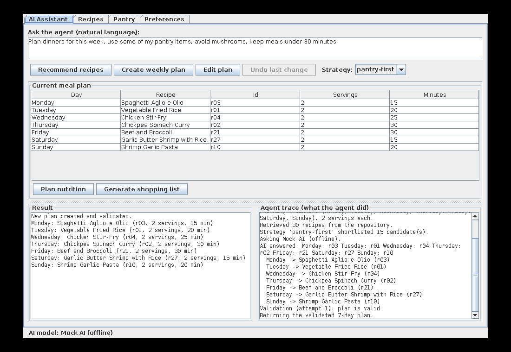

# SmartPlate — Implementation Guide (Code Explanation)

This document explains the Java implementation of the design in the Stage 1 report
([README.md](../README.md)). It covers how to build and run the project, how the code maps to the
class diagram, how each design pattern is implemented, and how each of the ten features (F01–F10)
runs through the code.

---

## 1. Build and run

Requirements: **Java 17+** and **Maven 3.8+**. No other installation is needed.

```bash
mvn test                 # compile and run the 74 JUnit 5 tests
mvn package              # builds target/smartplate-1.0.0.jar (includes all dependencies)

java -jar target/smartplate-1.0.0.jar          # desktop GUI (falls back to the CLI if there is no display)
java -jar target/smartplate-1.0.0.jar --cli    # command-line interface
java -jar target/smartplate-1.0.0.jar --mock   # force the offline Mock AI even if an API key is set
java -jar target/smartplate-1.0.0.jar --empty  # start with an empty pantry
```

You can also run it without packaging: `mvn -q compile exec:java -Dexec.args="--cli"`.

### Which AI model is used?

| Situation | AI model used |
|---|---|
| `ANTHROPIC_API_KEY` is **not** set (default for marking and testing) | `MockAIModel`, offline, no network, no cost |
| `ANTHROPIC_API_KEY` is set | `AIAdapter` → `AIClient` → Claude through the official Anthropic Java SDK |
| `--mock` flag | `MockAIModel`, even if a key is set |

The model id can be changed with `SMARTPLATE_AI_MODEL` (default `claude-opus-5-5`). The key is only
read from the environment and never appears in the source code. **Everything works without a key.**

### A quick CLI session

```text
> profile set diet=vegetarian allergies=peanuts dislikes=mushrooms time=30
> recommend 3 quick dinners using rice
> plan 5 dinners, avoid tomatoes, under 25 minutes
> trace                      # shows every step the agent took
> edit swap Tuesday for something with spinach
> undo
> nutrition plan
> shopping
> scale r10 4
> substitute r10 butter
```

Type `help` for the full list of commands.

### GUI



The GUI has four tabs: **AI Assistant** (F04, F05, F06, F09 and F10 for the plan), **Recipes** (F03,
F07, F08, F09 for a recipe), **Pantry** (F02) and **Preferences** (F01). The *Agent trace* panel
shows what the agent did for the last AI request, including any rejected answers and revisions.

---

## 2. Project structure

```
pom.xml
src/main/java/com/smartplate/
├── app/            SmartPlateApp            entry point; picks the AI model; starts GUI or CLI
├── presentation/   MealPlannerGUI, MealPlannerCLI                          (Presentation layer)
├── facade/         SmartRecipeFacade                                       (Application layer, Facade)
├── agent/          MealPlanningAgent, ConstraintValidator, ValidationResult, RequestConstraints
├── ai/             AIModel, AIAdapter, AIClient, MockAIModel, PromptFormat, AIServiceException   (Adapter)
├── strategy/       RecipeSelectionStrategy, PantryFirstStrategy, FastestMealStrategy             (Strategy)
├── command/        Command, ReplaceMealCommand, CommandHistory                                   (Command)
├── plan/           PlanComponent, MealPlan, PlannedMeal, Days                                    (Composite)
├── domain/         UserProfile, Pantry, PantryItem, Ingredient, Recipe, RecipeIngredient,
│                   NutritionInfo, ShoppingList, ShoppingItem, Substitution, PantryAction,
│                   Units, DietRules, SmartPlateException, InvalidProfileException  (Domain layer)
└── service/        RecipeRepository (Data layer), NutritionService, ServingScaler,
                    SubstitutionService, ShoppingListService, SampleData
src/test/java/com/smartplate/   15 JUnit 5 test classes, 74 tests
```

Each package matches a package in the class diagram (`docs/uml-diagrams/class/class-diagram.puml`).
Every class and method in the class diagram exists in the code under the same name.

### The layers and the call flow

```
MealPlannerGUI / MealPlannerCLI          (only talk to the facade)
            │
            ▼
     SmartRecipeFacade  ── owns: UserProfile, Pantry, current MealPlan
       │      │      │
       │      │      └── CommandHistory ──► ReplaceMealCommand ──► MealPlan
       │      └── NutritionService, ServingScaler, SubstitutionService, ShoppingListService
       ▼
 MealPlanningAgent ──► RecipeRepository.findAll()
                   ──► RecipeSelectionStrategy.selectRecipes()
                   ──► AIModel.generate()      (AIAdapter → AIClient → Claude,  or MockAIModel)
                   ──► ConstraintValidator.validateRecipe() / validatePlan()
```

---

## 3. Design patterns in the code

### 3.1 Facade — `facade/SmartRecipeFacade.java`

`SmartRecipeFacade` has one public method per feature (`setupProfile`, `managePantry`,
`searchRecipes`, `recommendRecipes`, `createMealPlan`, `editMealPlan`, `undoLastChange`,
`adjustServings`, `substituteIngredient`, `calculateRecipeNutrition`, `calculatePlanNutrition`,
`generateShoppingList`). `MealPlannerGUI` and `MealPlannerCLI` import no class from `agent`,
`service`, `command` or `ai`; they only call the facade. So both interfaces behave the same.
`SmartRecipeFacade.create(aiModel)` wires the whole subsystem together.

Errors are reported in one way: every expected problem throws a `SmartPlateException` whose
message can be shown to the user. The CLI prints it as `Error: ...` and the GUI shows a dialog.

### 3.2 Adapter — `ai/AIModel.java`, `ai/AIAdapter.java`, `ai/AIClient.java`, `ai/MockAIModel.java`

| Role | Class | What it does |
|---|---|---|
| Target | `AIModel` | `String generate(String prompt)`: the only interface the agent knows |
| Adapter | `AIAdapter` | Turns a prompt into the SDK's `MessageCreateParams` (`buildRequest`), and the SDK's `Message` back into plain text (`extractText`). Turns SDK exceptions into `AIServiceException`. |
| Adaptee | `AIClient` | Provider-specific client. `sendRequest(MessageCreateParams) : Message`, built on the official Anthropic Java SDK. Reads the key and model from the environment. |
| Alternative target implementation | `MockAIModel` | Offline model with the same interface (see 4.3) |
| Client | `MealPlanningAgent` | Holds an `AIModel`; never sees SDK types |

To support another provider you write a new client and adapter. `MealPlanningAgent` does not change.

### 3.3 Strategy — `strategy/*`

`RecipeSelectionStrategy.selectRecipes(recipes, profile, pantry)` returns the recipes that fit the
profile, best first. The agent passes the top 15 to the AI as `CANDIDATES`.

* `PantryFirstStrategy`: most pantry ingredients used first, then fastest.
* `FastestMealStrategy`: shortest cooking time first.
* Both use the shared pre-filter `RecipeSelectionStrategy.fitsProfile()` (time limit plus `DietRules`).

`MealPlanningAgent.setStrategy()` switches strategy at run time. The CLI command is
`strategy fastest`; the GUI has a combo box. A new rule is a new class, and the agent does not change.

### 3.4 Command — `command/*`

* `Command`: `execute()`, `undo()`, `getDescription()`.
* `ReplaceMealCommand`: stores `day`, `oldMeal`, `newMeal` and the receiver `MealPlan`.
  `execute()` calls `plan.replaceMeal(day, newMeal)`; `undo()` calls `plan.replaceMeal(day, oldMeal)`.
* `CommandHistory` (Invoker): `execute(command)` runs the command and pushes it on the undo stack;
  `undo()` pops it and calls `undo()`; `canUndo()` checks whether anything is on the stack.
* `MealPlanningAgent.editPlan()` **creates** the command but does not run it. The facade passes it
  to `CommandHistory.execute()` (SD05). Creating a new plan clears the history.

### 3.5 Composite — `plan/*`

* `PlanComponent`: `getNutrition()`, `getIngredients()`, `getCookingTime()`.
* `PlannedMeal` (leaf): one recipe times its servings. It scales the per-serving nutrition and
  scales ingredient quantities by `servings / recipe.servings`.
* `MealPlan` (composite): sums its 5–7 `PlannedMeal` children.
* `NutritionService.calculatePlan(PlanComponent)` and `ShoppingListService.generate(PlanComponent, Pantry)`
  never check whether they received a plan or a single meal. The test
  `ServicesTest.nutritionForRecipeAndPlan` calls `calculatePlan` on both.

---

## 4. The agent: how the AI is used (F04, F05, F06)

### 4.1 The loop

`MealPlanningAgent` (`agent/MealPlanningAgent.java`) implements the report's rule *"the LLM
proposes; deterministic code decides"*:

1. **Interpret the request.** `RequestConstraints.parse(request)` pulls out the few hard
   constraints written in the request ("5 dinners", "weekday", "vegetarian", "under 30 minutes",
   "avoid mushrooms", "for 4 people"). `applyTo(profile)` gives a copy of the profile with those added for
   this request only. The stored profile does not change.
2. **Retrieve.** `RecipeRepository.findAll()`.
3. **Shortlist.** `strategy.selectRecipes(...)`, up to 15 candidates. If none fit, the agent reports
   that before calling the AI.
4. **Ask the AI.** It builds a prompt in the `PromptFormat` protocol and calls `aiModel.generate(prompt)`.
5. **Parse and validate.** Every id must exist in `RecipeRepository`, so an invented recipe is
   rejected. Every recipe goes through `ConstraintValidator.validateRecipe()`, and a plan also goes
   through `validatePlan()` (5–7 days, one meal per day, servings ≥ 1).
6. **Revise once.** If there are violations, the agent asks the AI one more time. The new prompt
   adds `PREVIOUS_VIOLATIONS` (the exact messages) and `EXCLUDE` (the rejected ids).
7. **Return or report.** It returns a valid result, or throws `SmartPlateException` with the
   violations. **An invalid plan is never returned.**

`editPlan()` follows SD05: it gets one AI answer, validates it, and then either returns a
`ReplaceMealCommand` or reports an error (unknown day, invented recipe, same recipe, or a constraint
violation).

Every step is written to a trace (`getLastTrace()`). You can see it with `trace` in the CLI or in the
*Agent trace* panel of the GUI.

### 4.2 A real example: the AI makes mistakes and the agent revises

This was produced by the test-style scripted mock (vegetarian, peanut allergy, request
*"weekday dinners, avoid mushrooms, under 20 minutes"*, Fastest strategy). The first AI answer
contains a meat dish (`r04`), an invented id (`r999`) and only 4 valid days.

**First prompt (abridged):**

```text
TASK: PLAN
REQUEST: weekday dinners, avoid mushrooms, under 20 minutes
DIET: vegetarian
AVOID: peanuts, mushrooms
MAX_TIME: 20
EXCLUDE: none
CANDIDATES:
- r12 | Greek Salad with Chickpeas | 10 min | tags: vegetarian, gluten-free, quick, no-cook | ingredients: cucumber, tomato, ...
- r13 | Spinach and Cheese Omelette | 10 min | tags: vegetarian, gluten-free, quick | ingredients: egg, spinach, ...
- ... 6 more ...
DAYS: Monday, Tuesday, Wednesday, Thursday, Friday
RESPONSE_FORMAT: one line per day, '<Day>: <id>', for exactly these days: Monday, ... Friday.
```

**Agent trace:**

```text
Request: "weekday dinners, avoid mushrooms, under 20 minutes" (constraints from request: 5 days; max 20 min; avoid mushrooms)
Planning 5 dinners (Monday, Tuesday, Wednesday, Thursday, Friday), 2 servings each.
Retrieved 30 recipes from the repository.
Strategy 'fastest' shortlisted 8 candidate(s).
Asking Mock AI (offline).
AI answered: Monday: r03 Tuesday: r04 Wednesday: r01 Thursday: r11 Friday: r999
Validation (attempt 1): 4 violation(s) - 'r999' is not a recipe in the repository; choose only from CANDIDATES;
    The plan has 4 days; it must have 5 to 7; Tuesday: Chicken Stir-Fry (r04) contains chicken breast (not vegetarian);
    Tuesday: Chicken Stir-Fry (r04) takes 25 min (limit 20 min)
Revising: asking the AI again with the violation messages.
Asking Mock AI (offline) (revision).
AI answered: Monday: r12 Tuesday: r13 Wednesday: r03 Thursday: r08 Friday: r20
Validation (attempt 2): plan is valid
Returning the validated 5-day plan.
```

The second prompt is the same plus:

```text
EXCLUDE: r999, r04
PREVIOUS_VIOLATIONS:
- 'r999' is not a recipe in the repository; choose only from CANDIDATES
- The plan has 4 days; it must have 5 to 7
- Tuesday: Chicken Stir-Fry (r04) contains chicken breast (not vegetarian)
- Tuesday: Chicken Stir-Fry (r04) takes 25 min (limit 20 min)
```

### 4.3 The Mock AI

`MockAIModel` lets the whole system run and be tested offline. It has three modes:

* **heuristic** (default): it reads the prompt, drops candidates that clash with `DIET`, `AVOID`,
  `MAX_TIME` or `EXCLUDE`, ranks the rest by words shared with the request (a tag match scores
  higher), and answers in the requested `RESPONSE_FORMAT`. For edits it avoids recipes already in
  `CURRENT_PLAN`.
* **scripted** (`MockAIModel.scripted(...)`): returns fixed answers. Tests use this to force a bad
  first answer and check that the agent revises exactly once.
* **failing** (`MockAIModel.failing()`): always throws `AIServiceException`. This tests the "AI
  service fails" flows.

It records every prompt (`getPrompts()`) so tests can check what the agent sent.

### 4.4 The real AI

`AIAdapter.buildRequest()` sends a fixed system prompt. It tells the model to choose only from
`CANDIDATES`, never invent ids, respect the constraints, fix any `PREVIOUS_VIOLATIONS`, and reply
only in `RESPONSE_FORMAT`. The prompt itself is the user message. Choosing from a short list is a
simple task, so the request uses low effort. It also enables the API's server-side refusal
fallback. `extractText()` treats a refusal or an empty answer as `AIServiceException`. Because the
agent validates everything the model says, a wrong or badly formatted answer leads to a revision or
a reported failure, never to an invalid plan.

---

## 5. Feature walkthroughs

Each feature lists its entry point, the classes involved, and where its tests are.

| ID | Facade method → main code | Error cases handled | Tests |
|---|---|---|---|
| F01 Preferences | `setupProfile` → `UserProfile.validate()` | servings/time < 1, duplicates, malformed or empty entries, unknown diet → `InvalidProfileException`, previous profile kept | `UserProfileTest`, `SmartRecipeFacadeTest.f01...` |
| F02 Pantry | `managePantry(action, item)` → `Pantry.addItem/updateItem/removeItem` | quantity ≤ 0, unit not in g/kg/ml/l/pcs, update/remove of a missing item, ADD with an incompatible unit | `PantryTest`, `UnitsTest` |
| F03 Search | `searchRecipes` → `RecipeRepository.search` | empty query rejected; no match → empty list → "No recipes found" | `ServicesTest.searchMatches...` |
| F04 Recommend | `recommendRecipes` → `MealPlanningAgent.recommend` | AI failure, invented id, violations → one revision, then failure; no candidates | `MealPlanningAgentTest` |
| F05 Weekly plan | `createMealPlan` → `MealPlanningAgent.createPlan` | days outside 5–7, missing days, invalid recipes → one revision, then failure; AI failure | `MealPlanningAgentTest`, `RequestConstraintsTest` |
| F06 Edit & undo | `editMealPlan` → `agent.editPlan` → `CommandHistory.execute`; `undoLastChange` → `CommandHistory.undo` | no plan, unknown day, invented or invalid replacement, nothing to undo | `MealPlanningAgentTest`, `CommandHistoryTest` |
| F07 Servings | `adjustServings` → `ServingScaler.scale` | servings ≤ 0, invalid ingredient quantity | `ServicesTest.scaler...` |
| F08 Substitution | `substituteIngredient` → `SubstitutionService.findSubstitute` + `applySubstitution` | ingredient not in recipe, no substitute known, every substitute conflicts with the profile | `ServicesTest.substitution...` |
| F09 Nutrition | `calculateRecipeNutrition` / `calculatePlanNutrition` → `NutritionService` | missing nutrition data, empty plan, no plan | `ServicesTest.nutrition...` |
| F10 Shopping list | `generateShoppingList` → `ShoppingListService.generate` | empty plan, missing quantity (skipped with a note), incompatible units (separate lines, plus a note) | `ServicesTest.shoppingList...`, `ShoppingListTest` |

### Details worth knowing

* **Allergens are checked from ingredients, not tags** (report F04). `DietRules` checks each
  ingredient's *name and category*. It handles plurals ("mushrooms" → "mushroom"), whole words only
  ("nut" does not match "nutmeg"), and group terms (`nuts`, `gluten`, `shellfish`, `fish`, `soy`,
  `egg`, `dairy`). `ConstraintValidatorTest.mistaggedRecipeIsStillCaught` shows that a recipe tagged
  vegetarian but containing bacon is rejected.
* **Recipes are immutable.** Scaling and substitution return a copy (`Recipe.withServingsAndIngredients`),
  so the repository is never changed. This is why the report says only meal replacement is undoable.
  The CLI keeps the latest copy of each recipe as a working copy, so you can scale and then substitute.
* **Units.** `Units` converts kg↔g and l↔ml. The shopping list adds compatible units together,
  subtracts pantry stock in the same base unit, and shows large amounts as kg or l.
* **Substitutions** come from the fixed list in `SampleData.substitutions()`, filtered with `DietRules`.
  Example: a dairy-free user who substitutes sour cream gets coconut yogurt, not Greek yogurt.
* **Sample data.** `SampleData` holds 30 recipes, a starter pantry and 33 substitutions. Nutrition
  figures are approximate per-serving values for the demo.

---

## 6. Testing

```bash
mvn test
```

* 74 tests in 15 classes. They cover every feature, every pattern, and the main error flows from
  the use-case descriptions.
* All tests use `MockAIModel`, so they need no network or API key and always give the same result.
* `MealPlanningAgentTest` uses scripted answers to test the agent's behavior: rejecting invented
  ids, revising once with the violation messages, failing after one revision, and reporting AI
  service failures.
* `SmartRecipeFacadeTest.f04ToF10FullWorkflow` runs the whole workflow through the facade.
* `MealPlannerCLITest` runs a scripted CLI session and checks that errors are shown, not thrown.

---

## 7. Additions and small differences from the Stage 1 class diagram

The implementation follows the class diagram. The helper classes below were added; none of them
changes a pattern or a sequence diagram.

| Addition / difference | Why |
|---|---|
| `SmartPlateException`, `InvalidProfileException`, `AIServiceException` | The diagrams show "error" returns; these carry a user-facing message. |
| `Units`, `DietRules` (domain) | Shared unit conversion and ingredient-level diet/allergy rules, used by the validator, the strategies and the substitution service. |
| `RequestConstraints` (agent) | Applies constraints written in a request ("vegetarian", "avoid mushrooms", "under 30 minutes") deterministically, as in the report's example request. |
| `PromptFormat` (ai) | The plain-text protocol between the agent and any `AIModel`, so the mock and a real LLM read and write the same format. |
| `Days`, `SampleData`, `SmartPlateApp` | Day-name handling, built-in data, and the entry point. |
| `AIClient.sendRequest` takes and returns the SDK's request/response types | This makes `AIClient` a real adaptee whose interface differs from `AIModel` (the diagram writes the parameter as `prompt : String`). |
| `CommandHistory` uses `ArrayDeque` | Java's recommended stack class (the diagram says `Stack<Command>`). |
| Extra query methods on the facade (`getProfile`, `getPantry`, `getCurrentPlan`, `getRecipe`, `setStrategy`, `getLastAgentTrace`, ...) | The UIs need to read state. They still go through the facade only. |
| `UserProfile` stores the entries as typed | So `validate()` can report duplicates and malformed entries. The getters return cleaned sets. |
