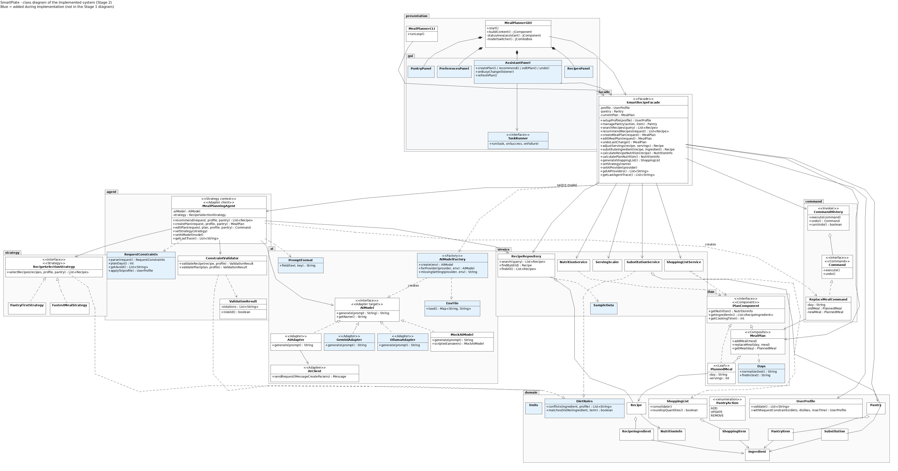
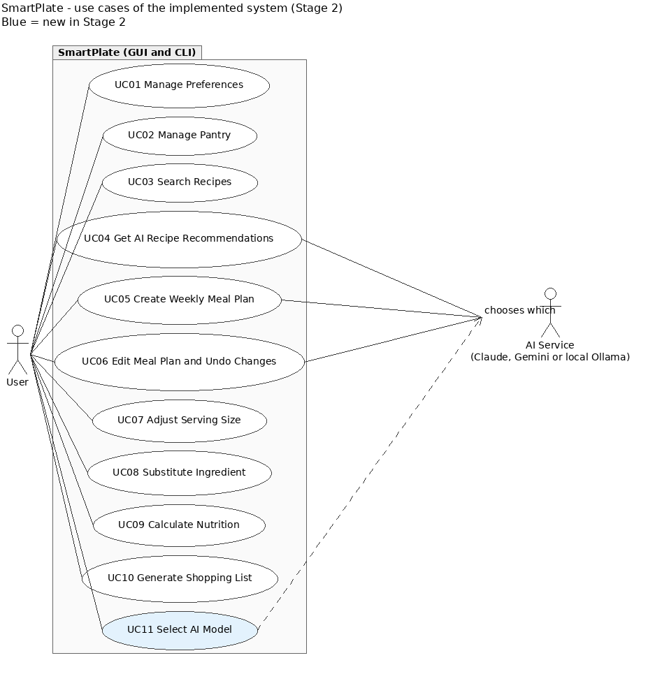
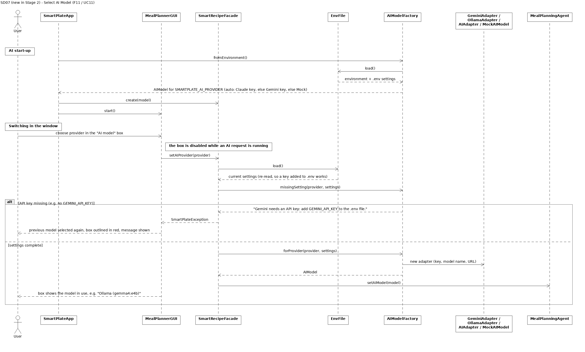

# SmartPlate — Stage 2 Implementation Report

**EECS 3311, Fall 2026 · AI-Human Collaborative Implementation**
Author: Shivam Glotra (individual project)  
Repository: <https://github.com/ShivamGlotra/EECS-3311-AI-Smart-Recipe-and-Meal-Planning-Agent>

> Still to add before submission: the video links (§7), the commits of 3–9 November (§6.1), and the
> LLM model name in §5.1.

## Contents
1. Project overview and implementation status
2. Feature to implementation mapping
3. Implemented design patterns (with the updated UML)
4. Changes and rationale
5. AI tools and collaboration log
6. Development and verification summary
7. Demonstration index

---

## 1. Project overview and implementation status

**What SmartPlate is.** SmartPlate is a Java 17 desktop application (Swing GUI) with a matching
command-line interface. It helps a home cook plan dinners: it keeps a preference profile and a pantry,
searches a recipe collection, recommends recipes and builds or edits a 5–7 day dinner plan with an AI
agent, scales recipes, substitutes ingredients, and computes nutrition and a shopping list.

**Users.** Home cooks and students who want quick, constraint-aware meal plans (diet, allergies,
dislikes, cooking time, what is already in the pantry).

**AI/LLM integration.** The agent (`MealPlanningAgent`) never lets the LLM invent anything. For each
request it reads hard constraints from the request text, retrieves the recipes, shortlists up to 15
candidates with the selected strategy, sends them to the LLM through the `AIModel` interface, parses
the answer, and **validates every chosen recipe in Java** (`ConstraintValidator`, using each recipe's
ingredient list). If anything is wrong it revises once with the violation messages; otherwise it
reports the failure. Four interchangeable models implement `AIModel`:

| Model | Class | Use |
|---|---|---|
| Mock AI (offline, deterministic) | `MockAIModel` | default without keys; all automated tests |
| Google Gemini (REST API) | `GeminiAdapter` | free/cheap cloud model, key in `.env` |
| Local model through Ollama (used: `gemma4:e4b`) | `OllamaAdapter` | free, runs on the user's machine |
| Anthropic Claude (official Java SDK) | `AIAdapter` → `AIClient` | optional, key in `.env` |

The model is chosen from `.env` at start-up and can be switched at run time in the GUI (feature F11).

**Implementation status.** All ten Stage 1 features (F01–F10) and one new feature (F11, AI model
selection) work in both the GUI and the CLI. All five Stage 1 design patterns are implemented, plus a
Factory for model creation. `mvn test` runs **132 automated tests (0 failures)**. Gemini and the local
Ollama model were run by the author; the Claude path is implemented but was only unit-tested, because no
Anthropic key was available.

**Limitations (honest list).**

* **No persistence:** profile, pantry and plan are kept in memory and lost when the app closes (not
  required by the course; listed as future work).
* **Plans always start on Monday**; one dinner per day.
* **Plan edits get one AI attempt** (no revision), as designed in SD05.
* **The offline Mock AI is simple:** it re-ranks the shortlist with word matching, so its picks are
  less clever than a real model's (it is meant for testing and offline demos).
* **Other tabs stay editable during a long AI request** (the AI model and strategy boxes are locked).
* **Sample data** (30 recipes, nutrition values) was written for the demo and not checked against a
  nutrition database.
* **Allergies match by ingredient name on purpose** (an allergy to "milk" also blocks "coconut milk").

---

## 2. Feature to implementation mapping

All paths are under `src/main/java/com/smartplate/`. Every feature is reached through
`SmartRecipeFacade` from both `MealPlannerGUI` (via the tab panels in `presentation/gui/`) and
`MealPlannerCLI`. "Video" links are filled in from §7.

### F01 — Preference Profile Management
| Field | Entry |
|---|---|
| Stage 1 reference | F01 / UC01 / SD01 |
| Status | **Implemented** (entries may now contain accented letters, e.g. "jalapeño") |
| Type | Deterministic |
| Classes / responsibilities | `PreferencesPanel` (form, error banner, field highlighting); `MealPlannerCLI` (`profile set …`); `SmartRecipeFacade` (entry point, keeps the active profile); `UserProfile` (data + `validate()` rules); `InvalidProfileException` (carries the problem list) |
| Key methods | `SmartRecipeFacade.setupProfile`, `UserProfile.validate`, `UserProfile.checkEntries`, `PreferencesPanel.save` |
| Design patterns | Facade |
| Video | §7, F01 |

**How it works.** The panel or CLI builds a `UserProfile` and calls `setupProfile`. `validate()`
returns every problem (servings or time below 1, unknown diet, duplicate or malformed entries). If the
list is empty the facade stores the profile; otherwise it throws `InvalidProfileException`, the previous
profile stays active, and the GUI lists the problems in a red banner and outlines each offending field.

### F02 — Pantry Inventory Management
| Field | Entry |
|---|---|
| Stage 1 reference | F02 / UC02 / SD01 |
| Status | **Implemented** (adding an item already in the pantry merges compatible units, e.g. 500 g + 1 kg) |
| Type | Deterministic |
| Classes / responsibilities | `PantryPanel` (form + table); `MealPlannerCLI` (`pantry add|update|remove`); `SmartRecipeFacade`; `Pantry` (items, rules); `PantryItem`, `Ingredient`, `PantryAction`; `Units` (unit families and conversion) |
| Key methods | `SmartRecipeFacade.managePantry`, `Pantry.addItem`, `Pantry.updateItem`, `Pantry.removeItem`, `Units.convert` |
| Design patterns | Facade |
| Video | §7, F02 |

**How it works.** `managePantry(action, item)` dispatches ADD / UPDATE / REMOVE to `Pantry`. Adding an
existing item converts and adds the quantity if the units are compatible; zero or negative quantities,
unknown units, incompatible units, and updating or removing a missing item are rejected with a message
shown next to the right field.

### F03 — Recipe Search
| Field | Entry |
|---|---|
| Stage 1 reference | F03 / UC03 / SD02 |
| Status | **Implemented** |
| Type | Deterministic |
| Classes / responsibilities | `RecipesPanel` (search box + results table); `MealPlannerCLI` (`search`, `recipes`, `show`); `SmartRecipeFacade`; `RecipeRepository` (the 30 recipes from `SampleData`) |
| Key methods | `SmartRecipeFacade.searchRecipes`, `RecipeRepository.search`, `RecipeRepository.findById`, `RecipeRepository.findAll` |
| Design patterns | Facade |
| Video | §7, F03 |

**How it works.** An empty query is rejected; otherwise every word of the query must appear in the
recipe's name, tags or ingredient names. The results table opens the selected recipe.

### F04 — AI Recipe Recommendation
| Field | Entry |
|---|---|
| Stage 1 reference | F04 / UC04 / SD03 |
| Status | **Modified** (constraints written in the request are enforced; see §4) |
| Type | Hybrid (AI chooses, Java validates) |
| Classes / responsibilities | `AssistantPanel` (request box, results, agent trace); `MealPlannerCLI` (`recommend`, `trace`); `SmartRecipeFacade`; `MealPlanningAgent` (the agent loop); `RequestConstraints` (rules read from the request); `RecipeSelectionStrategy` + `PantryFirstStrategy` / `FastestMealStrategy` (shortlist); `PromptFormat` (prompt/answer protocol); `AIModel` and its adapters (the LLM); `ConstraintValidator`, `ValidationResult`, `DietRules` (checks) |
| Key methods | `SmartRecipeFacade.recommendRecipes`, `MealPlanningAgent.recommend`, `RequestConstraints.parse/applyTo`, `RecipeSelectionStrategy.selectRecipes`, `AIModel.generate`, `ConstraintValidator.validateRecipe` |
| Design patterns | Facade, Strategy, Adapter |
| Video | §7, F04 |

**How it works.** The request ("3 quick vegetarian dinners using rice, avoid red onion") is parsed
into constraints that are added to a copy of the profile. The strategy filters and ranks all recipes
and keeps 15 candidates. The agent builds a prompt (`TASK`, `REQUEST`, `DIET`, `AVOID`, `MAX_TIME`,
`CANDIDATES`, `RESPONSE_FORMAT`) and asks the model, which answers `RECIPES: id, id`. Unknown ids and
recipes that fail validation become violations; the agent then asks once more with
`PREVIOUS_VIOLATIONS` and `EXCLUDE`. Only validated recipes are returned, and the trace shows each step.

### F05 — AI Weekly Meal Planning
| Field | Entry |
|---|---|
| Stage 1 reference | F05 / UC05 / SD04 |
| Status | **Modified** (request constraints, 5–7 day check before any AI call; see §4) |
| Type | Hybrid |
| Classes / responsibilities | as F04, plus `MealPlan` (composite: the plan), `PlannedMeal` (leaf: one dinner), `Days` (day names), `CommandHistory` (cleared for a new plan) |
| Key methods | `SmartRecipeFacade.createMealPlan`, `MealPlanningAgent.createPlan`, `RequestConstraints.planDays`, `MealPlan.addMeal`, `ConstraintValidator.validatePlan` |
| Design patterns | Facade, Strategy, Adapter, Composite |
| Video | §7, F05 |

**How it works.** The number of days (default 7) must be 5–7, else an error is shown without calling
the AI. The model answers one `Day: id` line per day; each id becomes a `PlannedMeal` in a `MealPlan`.
`validatePlan` checks every day exists and every recipe respects allergies, dislikes, diet and time.
One revision is allowed; the facade stores the valid plan and clears the undo history.

### F06 — Meal Plan Editing and Undo
| Field | Entry |
|---|---|
| Stage 1 reference | F06 / UC06 / SD05 |
| Status | **Modified** (the AI may choose the day when the request names none; day detection fixed; see §4) |
| Type | Hybrid |
| Classes / responsibilities | `AssistantPanel` (Edit plan / Undo, "CHANGED" marker, before/after card); `MealPlannerCLI` (`edit`, `undo`); `SmartRecipeFacade`; `MealPlanningAgent.editPlan`; `Days.findIn`; `ConstraintValidator`; `Command`, `ReplaceMealCommand` (stores day, old and new meal), `CommandHistory` (invoker, undo stack), `MealPlan` |
| Key methods | `SmartRecipeFacade.editMealPlan`, `SmartRecipeFacade.undoLastChange`, `MealPlanningAgent.editPlan`, `ReplaceMealCommand.execute/undo`, `CommandHistory.execute/undo/canUndo`, `MealPlan.replaceMeal` |
| Design patterns | Facade, Adapter, Command |
| Video | §7, F06 |

**How it works.** The agent finds the day named in the request (`Days.findIn`; "sun-dried" is not
Sunday), or lets the model pick it. The model answers `DAY:` and `RECIPE:`; the replacement must exist,
differ from the current meal and pass `validateRecipe`. The agent returns a `ReplaceMealCommand`, which
the facade runs through `CommandHistory`; Undo pops it and restores the old meal.

### F07 — Serving-Size Adjustment
| Field | Entry |
|---|---|
| Stage 1 reference | F07 / UC07 / SD06 |
| Status | **Implemented** |
| Type | Deterministic |
| Classes / responsibilities | `RecipesPanel` (Servings + Scale, working copy badge); `MealPlannerCLI` (`scale`); `SmartRecipeFacade`; `ServingScaler`; `Recipe` (immutable; scaling returns a copy) |
| Key methods | `SmartRecipeFacade.adjustServings`, `ServingScaler.scale` |
| Design patterns | Facade |
| Video | §7, F07 |

**How it works.** Every quantity is multiplied by `servings / recipe.servings`; fewer than 1 serving
or an invalid quantity is rejected. The scaled copy is shown as a working copy until Reset.

### F08 — Ingredient Substitution
| Field | Entry |
|---|---|
| Stage 1 reference | F08 / UC08 / SD06 |
| Status | **Implemented** (a disliked dairy food no longer rules out its plant-based substitute; see §4) |
| Type | Deterministic |
| Classes / responsibilities | `RecipesPanel` (ingredient box + Substitute); `MealPlannerCLI` (`substitute`); `SmartRecipeFacade`; `SubstitutionService` (33 known substitutions); `Substitution`; `DietRules` (conflict check) |
| Key methods | `SmartRecipeFacade.substituteIngredient`, `SubstitutionService.findSubstitute`, `SubstitutionService.applySubstitution`, `DietRules.conflicts` |
| Design patterns | Facade |
| Video | §7, F08 |

**How it works.** The facade checks the recipe contains the ingredient; the service returns the first
known substitute that does not conflict with the profile, then replaces the ingredient and converts the
quantity with the conversion factor (e.g. butter → olive oil ×0.8, in ml).

### F09 — Nutrition Information
| Field | Entry |
|---|---|
| Stage 1 reference | F09 / UC09 / SD06 |
| Status | **Implemented** |
| Type | Deterministic |
| Classes / responsibilities | `RecipesPanel` (recipe nutrition), `AssistantPanel` (Plan nutrition view); `MealPlannerCLI` (`nutrition <id>`, `nutrition plan`); `SmartRecipeFacade`; `NutritionService`; `NutritionInfo`; `PlanComponent`, `MealPlan`, `PlannedMeal` |
| Key methods | `SmartRecipeFacade.calculateRecipeNutrition/calculatePlanNutrition`, `NutritionService.calculateRecipe/calculatePlan`, `PlanComponent.getNutrition` |
| Design patterns | Facade, Composite |
| Video | §7, F09 |

**How it works.** A recipe's nutrition is its per-serving values times servings. For the plan,
`MealPlan.getNutrition()` sums `PlannedMeal.getNutrition()` of its children, so the service treats one
meal and the whole plan the same way.

### F10 — Shopping List Generation
| Field | Entry |
|---|---|
| Stage 1 reference | F10 / UC10 / SD06 |
| Status | **Implemented** (counted items are rounded up to whole pieces; see §4) |
| Type | Deterministic |
| Classes / responsibilities | `AssistantPanel` (Shopping list view, copy/export); `MealPlannerCLI` (`shopping`); `SmartRecipeFacade`; `ShoppingListService`; `ShoppingList`, `ShoppingItem`; `Pantry`; `PlanComponent` |
| Key methods | `SmartRecipeFacade.generateShoppingList`, `ShoppingListService.generate`, `PlanComponent.getIngredients`, `ShoppingList.consolidate`, `ShoppingList.roundUpQuantities` |
| Design patterns | Facade, Composite |
| Video | §7, F10 |

**How it works.** The plan's ingredients (collected through the Composite) are merged per ingredient in
compatible units, the pantry is subtracted, counted items are rounded up to whole pieces, and notes
explain skipped or incomparable lines. The GUI also lists what the pantry already covers.

### F11 — AI Model Selection (new)
| Field | Entry |
|---|---|
| Stage 1 reference | **New** (extends Stage 1 §1.5 "the provider can change without touching `MealPlanningAgent`") / new UC11 / new SD07 |
| Status | **New** |
| Type | Deterministic (chooses which LLM the hybrid features use) |
| Classes / responsibilities | `MealPlannerGUI` (AI model box; disabled during a request); `SmartRecipeFacade` (`setAIProvider`, `getAIProviders`); `AIModelFactory` (builds the right model, reports missing keys); `EnvFile` (reads `.env`); `GeminiAdapter`, `OllamaAdapter`, `AIAdapter`/`AIClient`, `MockAIModel`; `MealPlanningAgent.setAIModel`; `SmartPlateApp` (start-up choice, `--mock`) |
| Key methods | `SmartRecipeFacade.setAIProvider`, `AIModelFactory.fromEnvironment/create/forProvider/missingSetting`, `EnvFile.load`, `MealPlanningAgent.setAIModel`, `AssistantPanel.onBusyChange` |
| Design patterns | Adapter (two new adapters), Factory, Facade |
| Video | §7, F11 |

**How it works.** At start-up `SmartPlateApp` asks `AIModelFactory` for the model named by
`SMARTPLATE_AI_PROVIDER` (default `auto`: Claude if its key is set, else Gemini, else Mock). In the
window, choosing a provider calls `setAIProvider`, which re-reads `.env`; if the key is missing, the
previous model stays and the box shows the reason. Otherwise the factory builds the adapter and the
agent uses it from the next request on; a running request keeps the model it started with. The CLI uses
the start-up choice (or `--mock`).

---

## 3. Implemented design patterns

The updated UML is in `docs/umlet-diagrams/stage2/` (UMLet `.uxf` files plus PNG). The Stage 1 diagrams
are unchanged in `docs/umlet-diagrams/` for comparison.

*Class diagram of the implemented system (overview). Blue classes were added during implementation;
stereotypes show each pattern role. Full size: `docs/umlet-diagrams/stage2/class/SmartPlate_Stage2_ClassDiagram.png`
(UMLet source: `SmartPlate_Stage2_ClassDiagram.uxf` in the same folder).*

### 3.1 Facade
* **Problem.** Two user interfaces need the same ten features, and neither should know the agent,
  services, command history or AI classes.
* **Participants.** Facade: `SmartRecipeFacade`. Subsystem: `MealPlanningAgent`, `RecipeRepository`,
  `NutritionService`, `ServingScaler`, `SubstitutionService`, `ShoppingListService`, `CommandHistory`,
  `AIModelFactory`. Clients: `MealPlannerGUI` (and its panels), `MealPlannerCLI`.
* **Code.** `facade/SmartRecipeFacade.java`: one method per feature (`setupProfile` … `generateShoppingList`),
  plus `setStrategy` and `setAIProvider`.
* **How / why.** Each method validates its input, calls one subsystem, and returns a result or throws a
  `SmartPlateException` with a user-facing message, so the GUI and CLI behave identically and the
  presentation layer imports nothing below the facade.
* **Stage 1 match.** As designed; the facade also owns the session state and offers read methods (§4).

### 3.2 Adapter
* **Problem.** The agent must work with any LLM provider (and offline) without depending on a
  provider's API.
* **Participants.** Target: `AIModel` (`generate(prompt)`, `getName()`). Adapters: `AIAdapter` (Claude),
  `GeminiAdapter`, `OllamaAdapter`. Adaptee: `AIClient` (Anthropic SDK types `MessageCreateParams` /
  `Message`); the Gemini and Ollama REST APIs are adapted directly through the JDK `HttpClient`.
  Alternative implementation: `MockAIModel`. Client: `MealPlanningAgent`.
* **Code.** `ai/AIAdapter.java` (`buildRequest`, `extractText`), `ai/GeminiAdapter.java`
  (`buildRequestBody`, `extractText`), `ai/OllamaAdapter.java` (`buildRequestBody`, `extractText`,
  `stripThinking`), `ai/AIClient.java` (`sendRequest`).
* **How / why.** Each adapter turns the plain prompt into the provider's request and the provider's
  reply back into text, and maps provider errors to `AIServiceException`. Two providers were added in
  Stage 2 without changing the agent, which is exactly what the pattern promised.
* **Stage 1 match.** Extended (two more adapters; `AIClient.sendRequest` uses SDK types, §4).

### 3.3 Strategy
* **Problem.** Candidate recipes can be shortlisted in different ways, chosen at run time.
* **Participants.** Strategy: `RecipeSelectionStrategy` (with the shared filter `fitsProfile`).
  Concrete strategies: `PantryFirstStrategy`, `FastestMealStrategy`. Context: `MealPlanningAgent`
  (`setStrategy`, `shortlist`).
* **Code.** `strategy/*.java`; switched with `SmartRecipeFacade.setStrategy` from the GUI's Strategy box
  or the CLI's `strategy` command.
* **How / why.** The agent calls `selectRecipes` without knowing which rule is active; a new rule is a
  new class.
* **Stage 1 match.** As designed.

### 3.4 Command
* **Problem.** Plan edits must be undoable without the facade knowing how each edit is reversed.
* **Participants.** Command: `Command` (`execute`, `undo`). Concrete command: `ReplaceMealCommand`
  (day, old meal, new meal). Invoker: `CommandHistory` (stack). Receiver: `MealPlan`. Client:
  `MealPlanningAgent.editPlan` creates the command; `SmartRecipeFacade` executes and undoes it.
* **Code.** `command/*.java`, `MealPlan.replaceMeal`.
* **How / why.** The command stores what it needs to undo itself; a new plan clears the history.
* **Stage 1 match.** As designed (`ArrayDeque` instead of `Stack`, §4).

### 3.5 Composite
* **Problem.** Nutrition and shopping lists must be computed for one meal and for a whole plan.
* **Participants.** Component: `PlanComponent` (`getNutrition`, `getIngredients`, `getCookingTime`).
  Composite: `MealPlan` (5–7 meals). Leaf: `PlannedMeal` (one recipe at its servings). Clients:
  `NutritionService`, `ShoppingListService`.
* **Code.** `plan/*.java`.
* **How / why.** `MealPlan` sums its children, so the services treat a plan and a meal the same way.
* **Stage 1 match.** As designed.

### 3.6 Factory (added in Stage 2)
* **Problem.** Several `AIModel` implementations need configuration (keys, model names, URLs) read
  from the environment and `.env`, at start-up and when the user switches model.
* **Participants.** Factory: `AIModelFactory` (`create`, `forProvider`, `missingSetting`,
  `providerOf`). Products: the `AIModel` implementations. Configuration: `EnvFile`. Clients:
  `SmartPlateApp`, `SmartRecipeFacade.setAIProvider`.
* **How / why / impact.** All construction rules live in one class, so neither the entry point nor the
  facade knows the concrete adapters; adding a provider means one new adapter and one `case` (see §4,
  pattern changes).

### 3.7 Updated use-case and sequence diagrams
* **Use cases:** new **UC11 Select AI Model** (`use-case/SmartPlate_Stage2_UseCase.uxf`).
* **Sequence diagrams updated** because the Stage 1 versions became inaccurate: **SD03** (request
  constraints, 15-candidate shortlist, "no candidates" branch), **SD04** (request constraints and the
  5–7 day check), **SD05** (day from the request or chosen by the AI). **New SD07** for F11. SD01, SD02 and
  SD06 still match.

The updated SD03, SD04 and SD05 are in `docs/umlet-diagrams/stage2/sequence/` (PNG next to each `.uxf`).

---

## 4. Changes and rationale

### 4.1 Consolidated record

| # | Original design | Implemented change | Reason | Impact |
|---|---|---|---|---|
| 1 | Request text goes to the AI; the validator checks the **profile** (F04–F06) | `RequestConstraints` reads diet, "avoid …", time limit, number of days/items and servings from the request; `UserProfile.withRequestConstraints` adds them to a copy of the profile | An LLM can ignore constraints that are only in the prompt; this keeps "AI chooses, Java checks" true for the request too | New class in `agent/`; SD03–SD05 updated; the stored profile is never changed |
| 2 | `AIClient.sendRequest(prompt : String) : String` | `sendRequest(MessageCreateParams) : Message` (Anthropic SDK types) | With strings on both sides there would be nothing to adapt; now `AIClient` is a real adaptee | Adapter matches the textbook roles; agent unaffected |
| 3 | One external LLM behind `AIAdapter → AIClient` | `GeminiAdapter`, `OllamaAdapter` added; `AIModelFactory` picks one | Free/cheap models for the author (the course allows any cheap or free model); the design planned for provider changes | Agent unchanged; new Factory pattern; tests with fake servers |
| 4 | Model fixed at start | F11: switch in the GUI; `MealPlanningAgent.setAIModel`, `SmartRecipeFacade.setAIProvider`; one model per request; boxes locked while a request runs | Compare models in a demo; avoid a request answered by two models | New UC11 / SD07; GUI still only uses the facade |
| 5 | "Key from an environment variable" | `EnvFile` also reads a git-ignored `.env`; `.env.example` with placeholders | Easier local setup without committing keys (Stage 2 key-protection rule) | New class; README explains copy → fill → run |
| 6 | Free-form prompt and answer | `PromptFormat` `KEY: value` protocol shared by agent, mock and real models | Reliable parsing; the mock exercises the same parsing code | New class in `ai/` |
| 7 | Validation "using each recipe's ingredient list" | `DietRules` (ingredient-level matching: plurals, food groups, accents, dairy dislikes) and `Units` (unit conversion) | Validator, strategies, substitution and pantry need one shared set of rules | Two helper classes in `domain/` |
| 8 | Ten GUI screens (Appendix B) | Four tabs (AI Assistant, Recipes, Pantry, Preferences) built from `presentation/gui/*`; "Clean Slate" design chosen by the author | Fewer screen switches, every Appendix B screen still present | `MealPlannerGUI` delegates to four panels and small UI helpers |
| 9 | Conceptual CLI commands (`recipe search`, `plan create` …) | Short commands (`search`, `recommend`, `plan`, `edit`, `undo`, `scale`, …) plus `strategy` and `trace` | Shorter to type; `trace` shows the agent's steps | CLI help documents all commands |
| 10 | Facade shows `currentPlan` and the 12 feature methods | Facade also owns profile, pantry, last substitution; read methods for the UIs | UIs must display state without bypassing the facade | Layering preserved |
| 11 | `editPlan` with the day in the request | If no day is named, the AI chooses it (validated); `Days.findIn` keeps hyphenated words whole | Natural requests ("swap the shrimp dish …"); fixes "sun-dried" = Sunday | SD05 updated |
| 12 | `CommandHistory.undoStack : Stack<Command>` | `ArrayDeque<Command>` | Java's recommended stack | None |
| 13 | Errors shown as "error" returns | `SmartPlateException`, `InvalidProfileException`, `AIServiceException` | One user-facing message for both UIs, shown next to the field | New exception classes |
| 14 | Shopping list quantities as computed | Counted items rounded up to whole pieces, with a note | People buy whole items | `ShoppingList.roundUpQuantities` |
| 15 | Disliking an ingredient blocks every name containing it | A disliked dairy food ignores non-dairy ingredients named after it; allergies unchanged | "Milk" dislike blocked oat milk, its own substitute | `DietRules.matchesDislike` |
| 16 | Numbers in a request read as digits only ("9.5 days" was read as 5 days) | Decimals are read; days round to the nearest whole day, a half toward 5–7; recipe counts and servings round to nearest; time limits round down; huge numbers are an error | A user found that "dinner for 9.5 days" silently produced a 5-day plan | `RequestConstraints.roundTowardRange`, `number`; two tests |
| 17 | Not specified | `Days`, `SampleData` (30 recipes, pantry, 33 substitutions), `SmartPlateApp`, `MAX_CANDIDATES = 15` | Needed to run; short prompts | — |

### 4.2 New and substantially modified features (Section 3 of the instructions)

**F11 AI Model Selection — new.** (1) Original: none (new). (2) Implemented: the AI model box lists Mock,
Claude, Gemini and Ollama; choosing one switches the agent's model, or explains which key is missing;
start-up choice from `.env`/`SMARTPLATE_AI_PROVIDER`; `--mock` forces the mock. (3) Why: the course allows
cheap or free models and the author wanted to compare a free local model with a cloud model; the Stage 1
design already promised provider independence. (4) User need: users without a paid key can still use a
real LLM (local Ollama), and everyone can run offline. (5) Affected: new UC11 and SD07; classes
`AIModelFactory`, `EnvFile`, `GeminiAdapter`, `OllamaAdapter`, `MealPlannerGUI`, `SmartRecipeFacade`,
`MealPlanningAgent`, `AssistantPanel`, `SmartPlateApp`; methods `setAIProvider`, `setAIModel`,
`forProvider`, `missingSetting`, `onBusyChange`; patterns Adapter, Factory, Facade.

**F04/F05/F06 — modified.** (1) Original: F04, F05, F06. (2) Implemented: constraints in the request are
enforced as hard rules; plans need 5–7 days before any AI call; edits may let the AI choose the day; each
request uses one model. (3) Why: see rows 1, 4 and 11 above. (4) The original need (validated AI
choices) is met more strictly. (5) Affected: UC04–UC06, SD03–SD05, `MealPlanningAgent`,
`RequestConstraints`, `Days`, `ConstraintValidator`; patterns unchanged.

**F01, F08, F10 — small behaviour changes**, not new features: accented entries (F01), dairy dislikes vs
plant-based substitutes (F08), whole-piece rounding (F10). Use cases and patterns unchanged.

### 4.3 New and modified design patterns

**Factory — added.** (6) Original pattern: none. (7) Implemented: a static factory, `AIModelFactory`.
(8) Roles: factory `AIModelFactory`; products `AIAdapter`, `GeminiAdapter`, `OllamaAdapter`,
`MockAIModel` (all `AIModel`); configuration source `EnvFile`; clients `SmartPlateApp`,
`SmartRecipeFacade`. (9) Problem: model construction needs provider-specific settings at two places
(start-up and run-time switch). (10) Appropriate because it keeps construction out of the entry point
and the facade; architecture impact: one new class in `ai/`, presentation still unaware of adapters.

**Adapter — extended.** (6) Original: `AIAdapter → AIClient` plus `MockAIModel`. (7) Implemented: the
same pattern with two more adapters. (8) Roles as in §3.2. (9) Problem: support free providers.
(10) The agent and facade did not change, which confirms the Stage 1 choice.

The five Stage 1 patterns are all implemented; none was replaced.

---

## 5. AI tools and collaboration log

### 5.1 AI tools and models used for development

| Tool / platform | LLM model | Features, classes or tasks | Tokens and cost |
|---|---|---|---|
| **Claude Code** (Anthropic's coding agent, used in claude.ai/code cloud sessions) | *(model name as shown in the Claude Code session details)* | Generated the implementation of F01–F10 and the five patterns, the GUI redesign, the Gemini/Ollama adapters and the model switcher, most tests, the docs and this report's draft; diagnosed defects A1–A8, wrote the proposed fixes (the author applied A1–A7; A8 was committed by Claude Code at the author's request); produced the Stage 2 UMLet diagrams | **Money:** a Claude Pro subscription plus the US$100 of welcome usage credits that came with it, fully used; another month of Pro may be needed for Stage 3. **Tokens** (one session, 5–30 Oct 2026, from the session's usage record on 30 Oct): **94,291** input, **923,259** output, **228,438,517** cache-read and **5,327,924** cache-write tokens; usage valued at **≈ US$106.67** at API prices. |

No other AI tools were used. SmartPlate is an individual project, so every human contribution below is the author's.

**LLMs inside the product (run time, not development tools):** Mock AI (offline), Google Gemini
(`GEMINI_MODEL`, default `gemini-flash-latest`), a local Ollama model (used: `gemma4:e4b`), and
optionally Anthropic Claude (`SMARTPLATE_AI_MODEL`). Gemini and Ollama were used through free APIs, so
running them cost nothing; Claude was not used at run time.

### 5.2 Representative AI–human interactions

Drawn from the Claude Code session history and confirmed by the author.

| # | Task | Input / instruction | AI contribution | Human contribution | Outcome |
|---|---|---|---|---|---|
| CL-01 (5 Oct) | Implement the Stage 1 design in Java | "Make the complete project in Java implementing every feature as said in the report …" | Generated all classes from the class diagram, sample data, GUI and CLI over the facade, 88 tests, code documentation; followed SD05 where the text was silent (one AI attempt for edits) | Wrote the design that was implemented; chose the branch holding the final design | Incorporated (commit `0f85939`) |
| CL-02 (5 Oct) | Front-end options and a backend guide | Asked how a React/Flutter front end could use the Java logic, then for a Spring Boot guide; "do not make it or run … Do not make anything" | Explained the REST approach; wrote a conversion guide; stopped verifying it by building when told | Kept the AI to explanation only, protecting the project scope | Not incorporated (personal reference) |
| CL-03 (15 Oct) | GUI design proposals | "Give me a bunch of designs … and a Figma AI prompt" | Mockups of several directions with real sample data; Figma prompt | Asked whether the AI had read the code first; corrected the platform ("it is a desktop app, only light mode"); showed the current GUI; chose Direction B | Direction B became the specification |
| CL-04 (15 Oct) | Implement Direction B in Swing | Build it on a new branch | Four tab panels, FlatLaf theme, 14 GUI tests; tests and screenshots exposed four GUI bugs, which it fixed | Chose the design; required a separate branch; supplied the submitted Stage 1 report | Incorporated (`e4c412d`) |
| CL-05 (15 Oct) | Make the AI-written code understandable to its author | "Give me a complete guide … (I know React, not much Java)" | `DEVELOPER_GUIDE.md` with React analogies, function reference, walkthroughs | Asked for a format the author can learn from and maintain | Incorporated, kept up to date |
| CL-06 (15 Oct) | Question a technical choice | "Why JDK 21? … Why not JDK 25?" | Explained the Java 17 target and why 21 was recommended | Challenged an unexplained decision | No change |
| CL-07 (15 Oct) | Choose the AI model by configuration | The author's design: `OllamaAdapter implements AIModel`; the author wrote `AIModelFactory` and the new `SmartPlateApp.chooseModel` | Added the author's files unchanged; wrote `OllamaAdapter` to the factory's API; tested with a fake server; merged the author's Stage 1 merge into its branch | Designed the extension with the Stage 1 Adapter; wrote the factory; ran the app with `gemma4:e4b` | Incorporated (`7451c60`) |
| CL-08 (15 Oct) | Keep API keys out of git | "Can I have some safe way of adding the key that I don't have to push?" | Started implementing `.env` support **before approval** | Stopped it: "Don't keep adding things unless I ask. Tell me first."; reviewed and approved the change | Incorporated (`6eacd8f`) |
| CL-09 (15 Oct) | Gemini and a model switcher | "Add an adapter for Gemini … proper commits … an option on top right to switch models" | `GeminiAdapter` (chose the `gemini-flash-latest` alias after conflicting sources), switcher, four commits; fixed a truncated label found in a screenshot | Ran the app with both models locally; decided model names belong in `.env` | Incorporated (`5430d5a`, `4bf232f`) |
| CL-10 (23–28 Oct) | Check against the Stage 2 instructions | Pasted the Stage 2 PDF; "scan the repo … give me a roadmap" | Gap analysis (report format, UML, videos, commits); scanned history for leaked keys (none) | Set the scope; told the professor about the early start; chose the branching strategy (`develop` + `fix/*`) | Roadmap (phases A–F) |
| CL-11 (28 Oct) | Fix defects A1–A3 | "I can fix it. Just tell me where and how" | Reproduced each defect, explained the cause, wrote the code, tests and CLI/GUI test steps | **Implemented, tested and committed the fixes on separate branches**; kept the model defaults as they were | Incorporated (`6bfd56c`, `f70e701`, `86b5b1e`) |
| CL-12 (29 Oct) | Fix defects A4–A6 | "Give me all remaining fixes together … I will do it branch by branch" | Prepared and pre-tested four fixes on a scratch copy, plus patch files and test prompts | Applied each fix on its own branch, ran the checks, merged through PRs #6–#9 | Incorporated (`db82527`, `9deb476`, `82148d6`, `94a8a8a`) |
| CL-13 (29 Oct) | Stage 2 UML | Phase B | First drew the diagrams in PlantUML | Corrected the format: "We have to submit UMLet files" | Diagrams redone as UMLet `.uxf` (same style as Stage 1) |
| CL-14 (29 Oct) | Prepare the feature videos | Phase E1: a recording script | Wrote `docs/DEMO_SCRIPT.md` after running every error case in the CLI; found that a second `undo` printed "Undone." before the error, and prepared a fix with a test | Applied the A7 fix and committed it | Incorporated (`f8fe10f`) |
| CL-15 (29 Oct) | A bug found by the author | "Give me dinner for 9.5 days gives me a 5 day dinner"; then "round down or up whichever is closer" | Traced it to the number patterns (other decimals were also misread or ignored); implemented the rounding rule with two tests on `fix/decimalNumbersInRequests`; committed and pushed at the author's request | Found the bug; chose the rounding behaviour; reviewed and merged the branch (PR #10) | Incorporated (`c022ae4`) |

---

## 6. Development and verification summary

### 6.1 Branching strategy and commit summary
The author uses `main` ← `develop` ← short-lived `fix/*` / `feat/*` branches, merged through pull requests
with merge commits (no squash), so every commit stays visible. To count meaningful code commits on all
branches: `git log --all --no-merges -- src pom.xml`.

Implementation started before the Stage 2 period (the professor was informed); the stage counts total
meaningful code commits across the stage.

| Period (Toronto) | Meaningful code commits | Links |
|---|---|---|
| Before 20 Oct (early start) | 6 | [`0f85939`](https://github.com/ShivamGlotra/EECS-3311-AI-Smart-Recipe-and-Meal-Planning-Agent/commit/0f85939c6cf498b749ec0e24d527c96565d3591b) implementation of F01–F10 · [`e4c412d`](https://github.com/ShivamGlotra/EECS-3311-AI-Smart-Recipe-and-Meal-Planning-Agent/commit/e4c412df9004fba55bcb14b27702dc242b704e68) GUI redesign · [`7451c60`](https://github.com/ShivamGlotra/EECS-3311-AI-Smart-Recipe-and-Meal-Planning-Agent/commit/7451c60947415adcdcc0c1c4f940b401cb9ad672) model factory + Ollama · [`6eacd8f`](https://github.com/ShivamGlotra/EECS-3311-AI-Smart-Recipe-and-Meal-Planning-Agent/commit/6eacd8fedfb780e9351a36dcabe472a103effa15) `.env` · [`5430d5a`](https://github.com/ShivamGlotra/EECS-3311-AI-Smart-Recipe-and-Meal-Planning-Agent/commit/5430d5a60b560e6fe536aed9e9854072f8301ff5) Gemini · [`4bf232f`](https://github.com/ShivamGlotra/EECS-3311-AI-Smart-Recipe-and-Meal-Planning-Agent/commit/4bf232f8db80604dadf4b7e2ee406d4f345781bd) model switcher |
| 1: 20–26 Oct | 0 | (planning against the Stage 2 instructions) |
| 2: 27 Oct – 2 Nov | 9 | [`6bfd56c`](https://github.com/ShivamGlotra/EECS-3311-AI-Smart-Recipe-and-Meal-Planning-Agent/commit/6bfd56cb0beb90b7119c453886d2a93d1510aee3) whole-piece rounding · [`f70e701`](https://github.com/ShivamGlotra/EECS-3311-AI-Smart-Recipe-and-Meal-Planning-Agent/commit/f70e7019f2aec6cc3a948f6c0e9217382b0f8389) "sun-dried" day fix · [`86b5b1e`](https://github.com/ShivamGlotra/EECS-3311-AI-Smart-Recipe-and-Meal-Planning-Agent/commit/86b5b1e1cf74bcc80ce37ec172a38af6f112368e) multi-word avoid · [`db82527`](https://github.com/ShivamGlotra/EECS-3311-AI-Smart-Recipe-and-Meal-Planning-Agent/commit/db8252718e733b5973c79732fa81ece07d831b12) dairy dislikes · [`9deb476`](https://github.com/ShivamGlotra/EECS-3311-AI-Smart-Recipe-and-Meal-Planning-Agent/commit/9deb476d92eb3612731fb4691d64040870ee2fe8) one model per request · [`82148d6`](https://github.com/ShivamGlotra/EECS-3311-AI-Smart-Recipe-and-Meal-Planning-Agent/commit/82148d65124a2bb52b3e12a67ef1a88d8f01e81a) accented entries · [`94a8a8a`](https://github.com/ShivamGlotra/EECS-3311-AI-Smart-Recipe-and-Meal-Planning-Agent/commit/94a8a8af23cd176977b6dbfc8b441bfc0bd1f3e7) boundary tests · [`f8fe10f`](https://github.com/ShivamGlotra/EECS-3311-AI-Smart-Recipe-and-Meal-Planning-Agent/commit/f8fe10f19174e2c19e2413b9d536fdd188cca66d) CLI undo message · [`c022ae4`](https://github.com/ShivamGlotra/EECS-3311-AI-Smart-Recipe-and-Meal-Planning-Agent/commit/c022ae494397df99984956f9f1974aa27eb0614f) decimal numbers in requests |
| 3: 3–9 Nov | *(to be added)* | |
| **Total** | **15** | 15 required in total |

Pull requests: #3–#10 (one per fix branch; A7 was committed directly on `develop`). Documentation-only commits (report, diagrams, README) are not
counted.

### 6.2 Checks performed
* **Automated tests:** `mvn test` → **132 tests, 0 failures** (JUnit 5, all offline; 16 GUI tests run
  headless). The agent loop is tested with scripted bad AI answers; every AI adapter is tested against
  a fake server speaking its API.
* **Running the application:** the packaged jar was run through the CLI and the GUI after each change
  (GUI on a virtual display, with screenshots); the author ran it locally with Gemini and with
  the local Ollama model `gemma4:e4b`.
* **Each defect fix:** reproduced first (CLI/GUI), then a test that fails without the fix and passes with
  it, then the CLI/GUI check repeated.
* **Secrets:** the full git history was scanned for API-key patterns; none found. `.env` is git-ignored.

### 6.3 Important defects found and corrected

| Defect | How it was found | Fix |
|---|---|---|
| Pantry "Added …" message disappeared at once | new GUI test | message set after the row selection |
| Pantry error shown next to the wrong field | new GUI test | error-to-field mapping order |
| Preferences column clipped; table headers misaligned | GUI screenshots | layout fixes |
| Model name cut off in the AI model box ("Ollama (ge…") | GUI screenshot | box re-measured after each switch |
| A1 "13.5 pcs garlic" in the shopping list | review of CLI output | round counted items up (`6bfd56c`) |
| A2 "sun-dried" read as Sunday (edit failed or changed Sunday) | review of the day parser | `Days.findIn` (`f70e701`) |
| A3 "avoid red onion" avoided "red" (and red lentils) | review of the request parser | phrase-based `avoidedItems` (`86b5b1e`) |
| A4 disliking milk blocked oat milk as milk's substitute | substitution test | `DietRules.matchesDislike` (`db82527`; the commit message says "allergy", but the change applies to dislikes; allergies stay strict) |
| A5 a request could use two models if switched mid-way | code review | one model per request, boxes locked (`9deb476`) |
| A6 "jalapeño" rejected as malformed | manual test | accented letters accepted (`82148d6`) |
| A7 CLI printed "Undone." and then "Nothing to undo." | checking every error case for the demo script | undo first, print after; new CLI test (`f8fe10f`) |
| A8 "dinner for 9.5 days" made a 5-day plan; decimal time limits and servings were ignored | reported by the author while testing | decimals read and rounded, a half toward 5–7 days; huge numbers are an error (`c022ae4`) |

### 6.4 Remaining limitations
See §1. Stage 3 will add the full deterministic test report and the KUMA agent-behaviour testing.

---

## 7. Demonstration index

Each implemented feature has a labelled video segment. Recordings use a real model (Gemini or the local
Ollama model) for the AI features and show both the GUI and the CLI. The recording script is in
`docs/DEMO_SCRIPT.md`. Links and timestamps are added after recording.

| Feature | Shown in | Link / timestamp |
|---|---|---|
| F01 Preference Profile Management | GUI + CLI (invalid profile error) | *(to be added)* |
| F02 Pantry Inventory Management | GUI (merge units, error) + CLI | *(to be added)* |
| F03 Recipe Search | GUI + CLI (empty query error) | *(to be added)* |
| F04 AI Recipe Recommendation | GUI with trace + CLI | *(to be added)* |
| F05 AI Weekly Meal Planning | GUI (avoid, time limit; 8-day error) + CLI | *(to be added)* |
| F06 Meal Plan Editing and Undo | GUI (CHANGED marker, Undo) + CLI | *(to be added)* |
| F07 Serving-Size Adjustment | GUI + CLI | *(to be added)* |
| F08 Ingredient Substitution | GUI (dislike milk → oat milk) + CLI | *(to be added)* |
| F09 Nutrition Information | GUI (recipe and plan) + CLI | *(to be added)* |
| F10 Shopping List Generation | GUI (pantry subtracted, whole pieces) + CLI | *(to be added)* |
| F11 AI Model Selection (new) | GUI (switch model, missing-key message, boxes locked during a request) | *(to be added)* |
